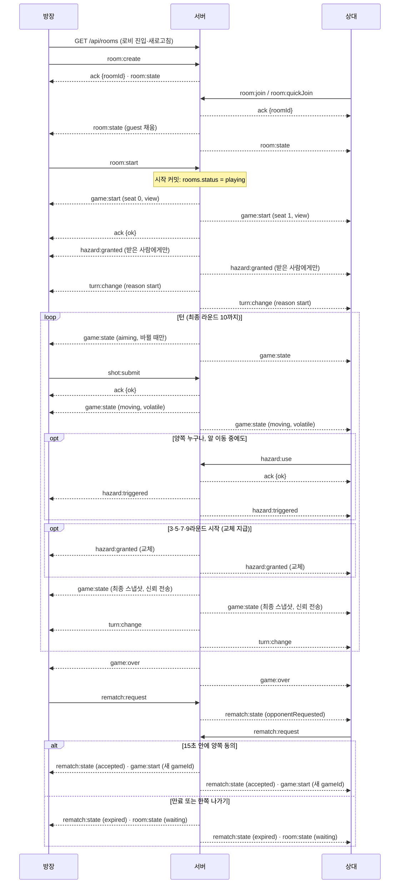

# API·실시간 통신 계약

## 상태

| 구분 | 상태 |
| --- | --- |
| 승인된 미구현 설계 | 전송 방식: 계정·조회는 REST, 방·대전은 Socket.IO, 세션 쿠키 공유 ([DEC-013](../DECISIONS.md#결정-색인)) |
| 현재 구현 | 없음 |
| 확정 (API-001·API-002 완료) | REST 경로 8개와 요청·응답 필드, 방 목록 새로고침 조회, `sim:result` 삭제, Socket.IO 이벤트 필드, 오류 형식·코드, 이벤트 순서, 상대 비공개 점검, 이름·식별자 확인, 본인 private 뷰의 게이지·쿨타임 필드 ([API-001](../TASKS.md#api-001-api실시간-이벤트-계약-확정), [API-002](../TASKS.md#api-002-api-이름식별자-확인과-private-뷰-필드-확정)) |
| 미정 | 발사 각도 범위(구현 때 정함) |

상위 구조는 [DESIGN](../DESIGN.md), 제품 동작은 [PRD](../PRD.md)를 따른다. 이 문서는 전송 방식·메시지·요청·응답·오류·검증 경계를 관리한다. 선택 이유는 [결정 기록](../DECISIONS.md)에 둔다. 아래 필드는 `shared`의 Zod 스키마로 옮길 수 있는 수준으로 적었고, 필드 이름은 `camelCase`다.

## 인터페이스

### 공통 타입

| 타입 | 값·필드 | 비고 |
| --- | --- | --- |
| `CharacterId` | `bear`·`cat`·`fox`·`rabbit`·`owl`·`frog` | [캐릭터 6종](../PRD.md#캐릭터-변경). 이름은 제안 |
| `BoardId` | `standard`(기본판)·`circle`(원형판) | [판 목록](../PRD.md#판-board). 판이 늘면 값을 추가한다 |
| `Seat` | `0` 또는 `1` | 경기 안 좌석. `users.id`를 쓰지 않는다 ([DEC-030](../DECISIONS.md#결정-색인)) |
| `HazardKind` | `board_spin`(판 돌리기)·`flashlight`(후레쉬)·`water_gun`(물총)·`desk_shake`(책상 흔들기)·`wall`(벽)·`sticky`(끈끈이)·`stun`(기절)·`bar_speed`(세기 막대 속도 조절)·`wind`(바람) | [방해요소 9종](../PRD.md#방해요소-규칙). 이름은 제안 |
| `Record` | `{ totalGames, wins, losses, draws }` | `draws = totalGames - wins - losses`로 서버가 계산한다. 승률은 클라이언트가 계산한다 |
| `Member` | `{ nickname, characterId, record: Record }` | 사용자 번호는 넣지 않는다 |
| `Me` | `{ nickname, characterId, record: Record }` | `GET /api/me`·로그인 응답 |

### REST API

모든 경로는 `/health`와 `signup`·`login`을 뺀 나머지에서 세션이 없으면 `401 UNAUTHENTICATED`를 돌려준다. 본문은 JSON이다. 오류는 `{ error: { code, message } }`다.

| 메서드 | 경로 | 요청 | 성공 응답 | 오류 코드 |
|---|---|---|---|---|
| POST | `/api/auth/signup` | `{ nickname, password }`. 닉네임 2~12자 한글·영문·숫자, 비밀번호 8~64자. 비밀번호 확인은 화면에서만 비교한다 | `201 {}` (세션을 만들지 않는다) | `INVALID_INPUT` 400, `NICKNAME_TAKEN` 409, `RATE_LIMITED` 429 |
| POST | `/api/auth/login` | `{ nickname, password }` | `200 { user: Me }` + 세션 쿠키 | `INVALID_INPUT` 400, `INVALID_CREDENTIALS` 401, `RATE_LIMITED` 429 |
| POST | `/api/auth/logout` | 없음 | `204` (세션이 없어도 204) | `RATE_LIMITED` 429 |
| GET | `/api/me` | 없음 | `200 { user: Me }` | `UNAUTHENTICATED` 401 |
| PATCH | `/api/me/password` | `{ currentPassword, newPassword }`. 새 비밀번호 8~64자 | `204`. 현재 세션만 남기고 다른 세션을 끝낸다 ([AUTH](AUTH.md#세션)) | `INVALID_INPUT` 400, `UNAUTHENTICATED` 401, `INVALID_CREDENTIALS` 401(현재 비밀번호 틀림) |
| PATCH | `/api/me/character` | `{ characterId: CharacterId }` | `200 { user: Me }` | `INVALID_INPUT` 400, `UNAUTHENTICATED` 401 |
| GET | `/api/rooms` | 없음 | `200 { rooms: RoomSummary[] }` | `UNAUTHENTICATED` 401 |
| GET | `/health` | 없음 (세션 불필요) | `200 { status: "ok" }`. DB를 조회하지 않는다 ([운영](OPERATIONS.md)) | 없음 |

`RoomSummary`는 `{ roomId, title, isPublic, status, host: Member }`다. `status`는 `waiting`(대기 중) 또는 `playing`(게임 중)이다. **비공개 방의 코드는 응답에 포함하지 않는다.** 알 개수·판·참여 인원도 포함하지 않는다([로비](../PRD.md#로비)). 방 수가 적어 페이지를 나누지 않고, 로비 진입·새로고침 때만 호출한다([DEC-024](../DECISIONS.md#결정-색인)).

- 랭킹·최근 경기 조회 경로는 두지 않는다 ([DEC-022](../DECISIONS.md#결정-색인)). 닉네임 변경 경로도 없다.
- 로그인한 사용자 본인 외의 사용자 번호는 어떤 응답에도 넣지 않는다.
- API 버전 접두사는 두지 않는다 (제안, 클라이언트와 서버를 같은 출처로 함께 배포).
- `INVALID_INPUT`의 `message`는 어느 필드가 틀렸는지 알려도 되지만, `INVALID_CREDENTIALS`는 닉네임 없음과 비밀번호 틀림을 구분하지 않는다.

### 오류 형식과 코드

- REST 오류는 `{ error: { code, message } }`로 응답한다. HTTP 상태는 위 표를 따른다.
- Socket.IO 명령은 ack 콜백으로 `{ ok: true, … }` 또는 `{ ok: false, error: { code, message } }`를 돌려준다.
- 거부된 명령은 경기 상태와 난수를 바꾸지 않는다.
- `RATE_LIMITED`(REST 429)에는 `Retry-After` 헤더(초)가 붙는다. `room:join` ack의 `RATE_LIMITED`에는 없다.

| 코드 | 사용처 |
| --- | --- |
| `INVALID_INPUT` | 요청·이벤트 입력이 스키마를 만족하지 않음 |
| `UNAUTHENTICATED` | 로그인하지 않았거나 세션이 만료됨 |
| `INVALID_CREDENTIALS` | 로그인·비밀번호 변경 실패. 닉네임 없음과 비밀번호 틀림을 구분하지 않는다 |
| `NICKNAME_TAKEN` | 가입 시 닉네임 중복 |
| `RATE_LIMITED` | 인증 요청 빈도 제한 초과 ([AUTH](AUTH.md#인증-요청-빈도-제한)), `room:join` 연결당 빈도 제한 초과 |
| `INVALID_CODE` | 비공개 방 코드가 맞지 않음. 비공개 방에 방 id만 보내 입장할 때도 쓴다 |
| `ROOM_FULL` | 이미 상대가 입장한 방 |
| `ROOM_PLAYING` | 게임이 시작된 방. `room:start`를 이미 시작된 방에 보낼 때도 쓴다 |
| `ROOM_NOT_FOUND` | 없는 방, 즉시 참가할 수 있는 방이 없음 |
| `CODE_TAKEN` | 방 생성 시 코드가 다른 방과 겹침. 다시 생성해 요청한다 |
| `ALREADY_IN_ROOM` | 이미 방장이거나 참여자인 사용자의 `room:create`·`room:join`·`room:quickJoin` (한 사람 한 방, [DATABASE](DATABASE.md#rooms)) |
| `NOT_IN_ROOM` | 방에 없는 사용자의 `room:start` |
| `NOT_HOST` | 방장이 아닌 사용자의 `room:start` |
| `ROOM_NOT_READY` | 상대가 입장하지 않은 방의 `room:start` |
| `GAME_NOT_ACTIVE` | 진행 중인 경기가 없음(경기 시작 전·종료 후)에 `shot:submit`·`hazard:use`·`game:forfeit`을 보냄. `game:forfeit`은 gameId가 현재 경기와 달라도 이 코드를 쓴다. 진행 중인 경기가 있는데 gameId·turnId·hazardInstanceId만 낡은 `shot:submit`·`hazard:use`는 `STALE_TURN`·`STALE_HAZARD`를 쓴다 |
| `STALE_TURN` | 발사 명령의 gameId·turnId가 현재 경기·턴과 다름. 같은 턴의 두 번째 발사에는 쓰지 않는다 ([DEC-026](../DECISIONS.md#결정-색인)) |
| `SHOT_ALREADY_SUBMITTED` | 같은 턴에 이미 발사해 `shotCommitted`로 두 번째 발사가 거부됨 ([GAME](GAME.md#명령-경합과-시간)). turnId가 맞는 요청이라 낡은 요청과 구분한다 |
| `NOT_YOUR_TURN` | gameId·turnId는 맞지만 현재 턴의 플레이어가 아님 |
| `INVALID_STONE` | 없거나 제거됐거나 내 알이 아닌 알 id |
| `PLAYER_STUNNED` | 기절 효과 중인 플레이어의 발사 |
| `STALE_HAZARD` | 방해요소 명령의 gameId 또는 hazardInstanceId가 현재 경기·보유와 다름 |
| `HAZARD_COOLDOWN` | 쿨타임 중인 쿨타임형 방해요소를 사용함 ([DEC-031](../DECISIONS.md#결정-색인)) |
| `HAZARD_OVERHEATED` | 과열 중에 피로도 게이지형 방해요소를 사용함 ([DEC-031](../DECISIONS.md#결정-색인)) |
| `HAZARD_INVALID_TARGET` | 벽·끈끈이의 위치·방향이 없거나 판 밖이거나 알·기존 벽·끈끈이와 겹침 ([GAME 방해요소별 처리](GAME.md#방해요소별-처리)) |
| `HAZARD_NOT_USABLE` | 랜덤형 방해요소를 직접 사용함 ([PRD 사용](../PRD.md#사용)). 경기 시작 전·종료 후 입력은 `GAME_NOT_ACTIVE`다 ([GAME 상태 전이](GAME.md#상태-전이와-순서)) |
| `REMATCH_NOT_AVAILABLE` | 결과 화면이 아니거나 재도전 15초가 지났거나 상대가 나간 뒤의 `rematch:request` |

방해요소 사용 거부는 `STALE_HAZARD`와 `HAZARD_*` 4종으로 응답한다. "효과가 진행 중"이라는 이유의 거부는 없다([DEC-031](../DECISIONS.md#결정-색인)). `HAZARD_*`와 이 절의 새 코드 이름은 개발자 B가 정했고 개발자 A가 GAME·LOCAL·OPERATIONS와 대조해 확인했다([API-002](../TASKS.md#api-002-api-이름식별자-확인과-private-뷰-필드-확정)). 목록은 이 절 한 곳에서 관리한다.

### Socket.IO 이벤트

- 연결 시 세션으로 사용자를 인증하며, 로그인하지 않은 사용자는 연결을 거부한다.
- 모든 C → S 명령은 ack 콜백으로 결과를 받는다. commandId를 두지 않는다. 발사는 gameId·turnId, 방해요소는 gameId·hazardInstanceId로 오래된 명령을 거부한다 ([GAME](GAME.md#명령-경합과-시간), [DEC-026](../DECISIONS.md#결정-색인)). 조준 값 전송 이벤트는 두지 않는다.
- AI 대전은 브라우저에서 실행하므로 서버 이벤트가 없다 (`ai:start` 삭제, [DEC-021](../DECISIONS.md#결정-색인)). 방 목록 구독 이벤트(`lobby:*`)도 없다([DEC-024](../DECISIONS.md#결정-색인)).
- 같은 계정의 새 연결이 생기면 기존 연결에 `session:replaced`를 보내고 끊는다.
- 시간은 서버 기준 epoch 밀리초(`…Ms`), 각도는 판 좌표계의 라디안이다. 좌표는 판 중심 원점, 선공 기준 오른쪽 x·상대 방향 y, 단위 cm다([GAME](GAME.md#물리와-입력-경계)).

| 방향 | 이벤트 | 설명 |
|---|---|---|
| C → S | `room:create` | 방 생성 (PvP만) |
| C → S | `room:join` | 방 입장 (공개 방은 방 id, 비공개 방은 방 코드) |
| C → S | `room:quickJoin` | 즉시 참가 (대기 중인 공개 방 중 무작위, 없으면 `ROOM_NOT_FOUND`. [로비](../PRD.md#로비)) |
| C → S | `room:leave` | 방 나가기 |
| C → S | `room:start` | 게임 시작 (방장만, 상대 입장 시) |
| S → C | `room:state` | 대기실 상태 |
| S → C | `room:closed` | 방장 이탈 등으로 방이 닫힘 |
| S → C | `game:start` | 게임 시작 (판, 알 배치, 선공) |
| S → C | `hazard:granted` | 방해요소 지급·교체 (게임 시작과 3·5·7·9라운드 시작. 받은 플레이어에게만 전송) |
| C → S | `hazard:use` | 방해요소 사용 |
| S → C | `hazard:triggered` | 방해요소 발동·종료 알림 (양쪽 공개) |
| S → C | `game:state` | 플레이어별 현재 게임 상태 (플레이어별 뷰) |
| C → S | `shot:submit` | 발사 |
| S → C | `turn:change` | 턴 변경 |
| C → S | `game:forfeit` | 기권 |
| S → C | `game:over` | 게임 종료 |
| C → S | `rematch:request` | 재도전하기 |
| S → C | `rematch:state` | 재도전 진행 상태 |
| S → C | `session:replaced` | 다른 접속으로 대체되어 로그아웃됨 |

`sim:result`(일괄 기록 이벤트)는 두지 않는다. 실시간 진행은 `game:state`로, 방해요소 발동은 `hazard:triggered`로 전달한다 ([ADR-0004](../adr/0004-realtime-hazards.md), [DEC-016](../DECISIONS.md#결정-색인)).

### 방 이벤트 필드

| 이벤트 | 요청 | 응답(ack) 또는 오류 |
| --- | --- | --- |
| `room:create` | `{ title, isPublic, pieceCount, board, code? }`. 제목 1~20자, 알 개수 5·7·9, `board`는 `BoardId`. 비공개면 `code` 필수(6자리, 영문 대문자·숫자에서 0/O·1/I 제외), 공개면 `code`를 보내지 않는다 | `{ ok: true, roomId }` 뒤에 방장에게 `room:state`. `INVALID_INPUT`, `CODE_TAKEN`(코드 중복), `ALREADY_IN_ROOM` |
| `room:join` | `{ roomId?, code? }`. 공개 방은 `roomId`, 비공개 방은 `code`(`roomId`는 선택, 함께 보내면 같은 방이어야 한다). 둘 다 없으면 `INVALID_INPUT` | `{ ok: true, roomId }` 뒤에 양쪽에 `room:state`. `INVALID_INPUT`, `ROOM_NOT_FOUND`, `ROOM_FULL`, `ROOM_PLAYING`, `INVALID_CODE`, `ALREADY_IN_ROOM`, `RATE_LIMITED` |
| `room:quickJoin` | 없음 | `{ ok: true, roomId }` 뒤에 양쪽에 `room:state`. `ROOM_NOT_FOUND`, `ALREADY_IN_ROOM` |
| `room:leave` | 없음 | `{ ok: true }` (방에 없어도 성공). 경기 중이면 서버가 기권패로 처리한다 |
| `room:start` | 없음 | `{ ok: true }`. `NOT_IN_ROOM`, `NOT_HOST`, `ROOM_NOT_READY`, `ROOM_PLAYING`. 시작 커밋 순서는 [GAME의 시작 커밋](GAME.md#상태-전이와-순서) |
| `room:state` (S → C) | — | `{ roomId, title, isPublic, pieceCount, board, status, host: Member, guest: Member \| null, isHost, code? }`. `code`는 **방장에게만** 담고 상대·목록에는 넣지 않는다. 입장·퇴장·재도전 만료 때 방 안 사용자 각각에게 보낸다 |
| `room:closed` (S → C) | — | `{ reason: "host_left" }`. 방장이 나가 방이 닫힘. 받은 클라이언트는 로비로 이동한다 |

- 입장은 서버가 `rooms`의 조건부 갱신(참여자가 비어 있고 상태가 `waiting`)으로 처리해 동시 입장 중 한 명만 성공시킨다 ([DB-001](../TASKS.md#db-001-db-스키마-확정)). 목록이 오래된 채 입장해도 이 시점에 최신 상태로 다시 검사한다.
- 코드 틀림 횟수 제한은 두지 않는다. 대신 `room:join`에 연결당 분당 30회 빈도 제한을 둔다 ([AUTH](AUTH.md#인증-요청-빈도-제한)).
- 비공개 방 코드는 방장에게만 보이며 `room:state`를 포함한 상대·목록 응답에는 넣지 않는다.
- AI 대전은 방 이벤트를 쓰지 않는다. `room:create`는 PvP만 받는다.

### 경기 이벤트 필드

경기 이벤트는 모두 경기의 `gameId`를 담는다. 재도전은 새 `gameId`를 만들므로 이전 경기의 이벤트와 명령은 `gameId`로 구분한다.

| 이벤트 | 요청 | 응답(ack) 또는 전송 내용 |
| --- | --- | --- |
| `game:start` (S → C) | — | `{ gameId, seat: Seat, players: [{ seat, nickname, characterId }, { seat, nickname, characterId }], board: BoardId, pieceCount, finalRound, turnSeconds, view: GameView }`. `seat`는 받는 사람의 좌석이다. `view`는 받는 사람의 초기 `GameView`다. `finalRound`(10)와 `turnSeconds`(30)는 [PRD](../PRD.md#게임-규칙) 값이다 |
| `hazard:granted` (S → C) | — | `{ gameId, hazardInstanceId, kind: HazardKind, round, replaced }`. 받은 플레이어에게만 보낸다. `replaced`는 이전 보유를 교체했는지 여부다. 게이지·쿨타임 상태는 `game:state`의 `private`로 받는다 |
| `hazard:use` (C → S) | `{ gameId, hazardInstanceId, target? }`. `target`은 `wall`·`sticky`에만 필수이며 `{ x, y, orientation? }`다. `orientation`(`horizontal`·`vertical`)은 `wall`에만 필수다. 좌표는 판 좌표계다 | `{ ok: true }`. `INVALID_INPUT`, `STALE_HAZARD`, `HAZARD_COOLDOWN`, `HAZARD_OVERHEATED`, `HAZARD_INVALID_TARGET`, `HAZARD_NOT_USABLE`, `GAME_NOT_ACTIVE`. 내 턴·상대 턴과 알 이동 여부에 관계없이 쿨타임·피로도 과열 제한을 충족하면 허용한다. 랜덤형은 서버가 자동 발동한다 (DEC-015·017·031) |
| `hazard:triggered` (S → C) | — | `{ gameId, kind, phase, sourceSeat, targetSeat, startsAtMs, expiresAtMs, params? }`. `phase`는 `start`·`end`. `params`는 `wall`·`sticky`의 `{ x, y, orientation? }`, `wind`의 `{ directionRad }`, `bar_speed`의 `{ multiplier }`, `board_spin`의 `{ angleDeg }`이며 양쪽에 같게 보낸다. 시야 가림(`flashlight`·`water_gun`)의 가림 모양은 넣지 않고 대상의 `game:state`로만 보낸다 |
| `game:state` (S → C) | — | `GameView`(아래). 알이 움직이는 동안은 volatile, 조준 중에는 바뀔 때만, 알이 모두 멈춘 최종 스냅샷은 신뢰 전송이다 ([GAME](GAME.md#전송과-표시-초안)) |
| `shot:submit` (C → S) | `{ gameId, turnId, stoneId, angle, power }`. 세기는 0 초과 100 이하(세기 0은 발사하지 않음, [PRD](../PRD.md#게임-규칙)), `angle`은 판 좌표계 라디안. 각도 범위는 구현 때 정한다 | `{ ok: true }`. `INVALID_INPUT`, `GAME_NOT_ACTIVE`, `STALE_TURN`, `SHOT_ALREADY_SUBMITTED`, `NOT_YOUR_TURN`, `INVALID_STONE`, `PLAYER_STUNNED` ([DEC-026](../DECISIONS.md#결정-색인)). 적용 결과는 `game:state`로 받는다 |
| `turn:change` (S → C) | — | `{ gameId, turnId, round, activePlayerId: Seat, deadlineMs, serverNowMs, reason }`. `reason`은 `start`(경기 첫 턴)·`resolved`(발사 처리 뒤)·`timeout`(시간초과) |
| `game:forfeit` (C → S) | `{ gameId }` | `{ ok: true }`. `GAME_NOT_ACTIVE`, `INVALID_INPUT` |
| `game:over` (S → C) | — | `{ gameId, winnerId: Seat \| null, reason, remainingStones: [n0, n1], rematchDeadlineMs: number \| null }`. `winnerId`가 `null`이면 무승부다. `reason`은 `all_stones_out`(알 모두 제거)·`final_round`(최종 라운드 알 수 비교)·`forfeit`(기권·이탈)·`timeout_forfeit`(연속 시간초과 강제 기권). 상대가 나가 재도전할 수 없으면 `rematchDeadlineMs`는 `null`이다. 레이팅은 없다 ([DEC-022](../DECISIONS.md#결정-색인)) |
| `rematch:request` (C → S) | `{ gameId }`. 끝난 경기의 id | `{ ok: true }`. `REMATCH_NOT_AVAILABLE`, `INVALID_INPUT` |
| `rematch:state` (S → C) | — | `{ gameId, myRequested, opponentRequested, deadlineMs, outcome }`. `outcome`은 `pending`·`accepted`·`expired`. `accepted`면 새 `gameId`의 `game:start`가 이어지고, `expired`면 `room:state`(대기 중)가 이어진다. 15초 기준은 [게임 화면](../PRD.md#게임-화면) |
| `session:replaced` (S → C) | — | `{ reason }`. `reason`은 `new_connection`·`password_changed`. 서버가 연결을 끊고, 게임 중이면 기권패 처리한다 ([AUTH](AUTH.md#socketio-인증중복-접속)) |

`GameView`는 [GAME의 공개 GameView·본인 private](GAME.md#상태-위치와-플레이어별-뷰)를 따르며 필드는 아래와 같다.

| 필드 | 타입 | 비고 |
| --- | --- | --- |
| `gameId`, `serverTick`, `serverNowMs`, `revision` | 숫자·문자열 | `revision`·`serverTick`이 오래된 상태는 클라이언트가 버린다 |
| `phase` | `waiting`·`aiming`·`moving`·`resolving`·`finished` | |
| `turnId`, `round`, `activePlayerId`, `deadlineMs` | 숫자·`Seat`·ms | |
| `boardRotationDeg` | 숫자 | 판 돌리기 누적 회전 |
| `stones` | `[{ id, ownerId: Seat, x, y, h }]` | 제거된 알은 포함하지 않는다 |
| `effects` | `[{ kind, targetSeat, startsAtMs, expiresAtMs, params? }]` | 양쪽에 같게 보내는 공개 활성 효과. 벽·끈끈이의 위치 포함 |
| `result` | `null` 또는 `game:over`와 같은 결과 | 확정 후에만 |
| `private` | 아래 | **받는 사람 본인의 것만** |

`private`는 `{ held: { hazardInstanceId, kind, round } \| null, fatigueGauge: number \| null, overheated: boolean, cooldownEndsAtMs: number \| null, usable: boolean, timeoutStreak, blind? }`다. `blind`는 내가 시야 가림 대상일 때의 가림 모양과 만료 시각이다. `fatigueGauge`·`overheated`·`cooldownEndsAtMs`·`usable`의 의미는 [GAME 상태 위치와 플레이어별 뷰](GAME.md#상태-위치와-플레이어별-뷰)를 따르며 `held`가 `null`이면 `null`·`false`다.

### 이벤트 순서

순서 규칙 (제안):

1. 한 연결 안에서 신뢰 전송 이벤트는 보낸 순서대로 도착한다(Socket.IO). 클라이언트는 `gameId`가 현재 경기와 다른 이벤트를 버린다.
2. `room:start`는 시작 커밋 → `game:start` 전송 → 방장 ack 순서다. 시작 커밋보다 먼저 관찰된 이탈은 대기실 처리, 뒤의 이탈은 기권패다([GAME](GAME.md#상태-전이와-순서)).
3. 경기 시작 때의 `hazard:granted`는 `game:start` 뒤, 첫 `turn:change` 앞에 온다. 라운드 교체 지급은 [GAME](GAME.md#상태-전이와-순서)의 종료 판정 → 교체 → 다음 턴 주인 변경 → 뷰·`turn:change` 순에 따라 그 턴의 최종 `game:state`보다 먼저 보낸다. 최종 스냅샷의 `private.held`가 교체 뒤의 값이 되며, 교체가 없는 턴은 최종 `game:state` → `turn:change` 순이다.
4. 발사 ack는 명령 수락·거부만 뜻한다. 결과는 이후 `game:state`·`hazard:triggered`로 받는다.
5. `game:state`는 `revision`이 커지는 순서로만 적용한다. volatile 스냅샷이 유실돼도 마지막 신뢰 전송 스냅샷이 서버 상태로 수렴시킨다. 연결이 끊기면 재접속 복구는 없다.
6. `game:over` 뒤에는 `game:state`·`hazard:triggered`·`turn:change`를 보내지 않으며 이후 `shot:submit`·`hazard:use`·`game:forfeit`은 `GAME_NOT_ACTIVE`로 거부한다. 재도전으로 새 경기가 시작된 뒤 이전 경기의 명령은 `STALE_TURN`·`STALE_HAZARD`(`game:forfeit`은 `GAME_NOT_ACTIVE`)다.
7. 재도전이 성립해도 `rooms.status`는 `playing`으로 유지하며, 만료·한쪽 나가기면 `room:state`로 대기실 상태를 보낸다([DATABASE](DATABASE.md#방-생명주기)).

### 상대 비공개 필드 점검

상대에게 가는 이벤트마다 필드를 나열하고 상대의 보유 방해요소 정보(종류·개수·게이지·쿨타임·교체 추첨·난수 시드·자동 발동 예정 시각)와 사용자 번호가 들어갈 자리가 없음을 확인한다. 이 표는 계약 문서의 필드 목록을 대조한 것이며, 구현 후에는 `getViewFor`의 허용 목록 테스트로 같은 조건을 검증한다([GAME](GAME.md#상태-위치와-플레이어별-뷰)).

| 이벤트·응답 | 상대(또는 목록 조회자)에게 가는 필드 | 상대 보유 정보 | 판정 |
| --- | --- | --- | --- |
| `GET /api/rooms` | `roomId`, `title`, `isPublic`, `status`, 방장 `Member` | 없음. 비공개 코드·사용자 번호 없음 | 통과 |
| `room:state` | 방·방장·상대 `Member`, `isHost`, 방장에게만 `code` | 없음. 상대 사본에는 `code` 없음 | 통과 |
| `room:closed` | `reason` | 없음 | 통과 |
| `game:start` | `gameId`, `seat`, `players`(좌석·닉네임·캐릭터), 판·알·라운드·시간, 내 `view` | 없음. `view.private`는 받는 사람 본인 것 | 통과 |
| `hazard:granted` | **받은 플레이어에게만** 전송. 상대에게는 이벤트를 보내지 않음 | 해당 없음 (전송 안 함) | 통과 |
| `game:state` | 공개 필드(`stones`·`effects`·`turn*`·`result`)와 내 `private`. 상대의 `held`·게이지·쿨타임·`timeoutStreak`·`blind`는 만들지 않음 | 없음. 보유 개수도 보내지 않음 | 통과 |
| `hazard:triggered` | `kind`, `phase`, 두 좌석, 시각, 효과 `params`. 지급된 `hazardInstanceId`·게이지·쿨타임·시야 가림 모양 없음 | 사용·발동된 효과의 이름·효과만(양쪽 공개 규칙, [PRD](../PRD.md#방해요소-규칙)) | 통과 |
| `turn:change` | `turnId`, `round`, `activePlayerId`, 마감 시각, `reason` | 없음 | 통과 |
| `game:over` | `winnerId`, `reason`, `remainingStones`, `rematchDeadlineMs` | 없음. 남은 보유 방해요소를 공개하지 않음 | 통과 |
| `rematch:state` | 요청 여부, 마감 시각, 결과 | 없음 | 통과 |
| `session:replaced` | `reason` (본인 연결에만) | 해당 없음 | 통과 |

- 랜덤형 방해요소(`bar_speed`·`wind`)의 자동 발동 시각은 지급 때 시드로 정해지지만 발동 전에는 어떤 이벤트에도 담지 않는다. 발동한 뒤 `hazard:triggered`로만 양쪽에 알린다.
- 사용자 번호(`users.id`)는 어떤 이벤트·응답에도 담지 않고 좌석 값과 닉네임만 쓴다([DEC-030](../DECISIONS.md#결정-색인)).

---

## 계약 확정 전 확인할 항목

- 인증 전달·실패 응답·권한 검사 위치: [인증 설계](AUTH.md)
- 발사 각도 범위 (구현 때 정함)
- 호환성·버전 변경

이벤트명은 `shared`에 한 곳으로 정의하며 LOCAL의 [`GameSession`](LOCAL.md#gamesession-시그니처)과 같은 타입을 쓴다. 표에 있는 30초 등의 제품 값은 [게임 규칙](../PRD.md#게임-규칙)을 참조하며 여기서 새로 결정하지 않는다.
