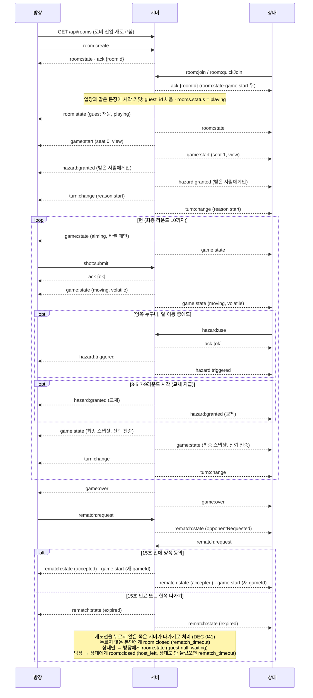

# API·실시간 통신 계약

## 상태

| 구분 | 상태 |
| --- | --- |
| 승인된 미구현 설계 | 전송 방식: 계정·조회는 REST, 방·대전은 Socket.IO, 세션 쿠키 공유 ([DEC-013](../DECISIONS.md#결정-색인)) |
| 현재 구현 | `shared`의 Zod 스키마와 이벤트 필드 타입([IMPL-002](../TASKS.md#impl-002-game-core), PR 병합 전). 서버·클라이언트 연동은 없음. 방 이벤트·`GET /api/rooms`는 서버가 구현했다(`packages/server/src/rooms`, [IMPL-008](../TASKS.md#impl-008-로비방-서버)). 경기 이벤트의 서버 연동은 IMPL-009 |
| 확정 (API-001·API-002 완료) | REST 경로 8개와 요청·응답 필드, 방 목록 새로고침 조회, `sim:result` 삭제, Socket.IO 이벤트 필드, 오류 형식·코드, 이벤트 순서, 상대 비공개 점검, 이름·식별자 확인, 본인 private 뷰의 게이지·쿨타임 필드 ([API-001](../TASKS.md#api-001-api실시간-이벤트-계약-확정), [API-002](../TASKS.md#api-002-api-이름식별자-확인과-private-뷰-필드-확정)) |
| 미정 | 없음. 발사 각도 범위는 (−π, π]로 확정([DEC-061](../DECISIONS.md#결정-색인)) |

상위 구조는 [DESIGN](../DESIGN.md), 제품 동작은 [PRD](../PRD.md)를 따른다. 이 문서는 전송 방식·메시지·요청·응답·오류·검증 경계를 관리한다. 선택 이유는 [결정 기록](../DECISIONS.md)에 둔다. 아래 필드는 `shared`의 Zod 스키마로 옮길 수 있는 수준으로 적었고, 필드 이름은 `camelCase`다.

## 인터페이스

### 공통 타입

| 타입 | 값·필드 | 비고 |
| --- | --- | --- |
| `Appearance` | `{ headShape, hair, eyebrows, eyes, nose, lips, skinTone }`, 각 값은 정수 0~4 | 사람 아바타 외형([DEC-054](../DECISIONS.md#결정-색인)·[DEC-059](../DECISIONS.md#결정-색인)). 고정 기본 외형은 모든 값 0. 머리색은 `hair` 선택지에 딸려 있다. 요청 검사는 `shared`의 `AppearanceSchema`(7항목 모두 필요, 여분 필드 거부)이고, 선택지 모양 정의(번호 → 부품)는 같은 파일(`avatar.ts`)의 `AVATAR_PARTS` 한 곳에 두고 3D·SVG가 같이 쓴다. 저장값을 읽을 때는 없는 필드·범위 밖 값을 0으로 읽는다(`normalizeAppearance`). 항목이 늘면 필드를 더한다. 동물 6종 `CharacterId`는 [IMPL-018](../TASKS.md#impl-018-사람-아바타-구현)에서 지웠다 |
| `BoardId` | `standard`(기본판)·`circle`(원형판) | [판 목록](../PRD.md#판-board). 판이 늘면 값을 추가한다 |
| `ThemeId` | `bar`(바, 기본)·`rooftop`(밤 옥상)·`classroom`(교실)·`beach`(해변) | [방 테마](../PRD.md#방-생성)([DEC-052](../DECISIONS.md#결정-색인)·[DEC-053](../DECISIONS.md#결정-색인)). 장면 표시에만 쓴다. `game-core`(`Game`)에는 넘기지 않고 `game-runtime`은 닉네임처럼 `game:start`에 담기만 한다. 테마가 늘면 값을 추가한다. 스키마는 `shared`의 `ThemeIdSchema`([IMPL-015](../TASKS.md#impl-015-방-테마-구현)) |
| `Seat` | `0` 또는 `1` | 경기 안 좌석. `users.id`를 쓰지 않는다 ([DEC-030](../DECISIONS.md#결정-색인)) |
| `HazardKind` | `board_spin`(판 돌리기)·`flashlight`(후레쉬)·`water_gun`(물총)·`desk_shake`(책상 흔들기)·`wall`(벽)·`sticky`(끈끈이)·`stun`(기절)·`bar_speed`(세기 막대 속도 조절)·`wind`(바람) | [방해요소](../PRD.md#방해요소-규칙). [DEC-055](../DECISIONS.md#결정-색인)([IMPL-016](../TASKS.md#impl-016-방해요소-10종-추가와-턴-교체))로 `magnet`(자석)·`gravity_zone`(중력 구역)·`ice_floor`(미끄럼 장판)·`decoy`(분신술)·`fake_wall`(가짜벽)·`heavy_stones`(알 무게 변화)·`reverse_zone`(방향 반전 구역)·`mine`(폭탄)·`pit`(바닥 없어지기)·`moving_wall`(이동 장애물)을 더한다. `desk_shake`는 지급하지 않지만 기존 이벤트 파싱을 위해 값은 남긴다 |
| `Record` | `{ totalGames, wins, losses, draws }` | `draws = totalGames - wins - losses`로 서버가 계산한다. `shared`의 타입 이름은 내장 `Record`와 겹치지 않게 `PlayerRecord`다. 승률은 클라이언트가 계산한다 |
| `Member` | `{ nickname, appearance: Appearance, record: Record }` | 사용자 번호는 넣지 않는다 |
| `Me` | `{ nickname, appearance: Appearance, record: Record }` | `GET /api/me`·로그인 응답 |

꾸미기 창의 저장 버튼이 `PATCH /api/me/appearance`를 한 번 보낸다. AI 대전의 AI 좌석 외형은 브라우저가 대전을 열 때 무작위로 만들어 `game:start`에 담고 재도전에서는 그대로 쓴다. 로컬 2인은 계정이 없어 두 사람에게 서로 다른 고정 외형을 쓴다([DEC-059](../DECISIONS.md#결정-색인), [IMPL-018](../TASKS.md#impl-018-사람-아바타-구현)).

### REST API

모든 경로는 `/health`와 `signup`·`login`을 뺀 나머지에서 세션이 없으면 `401 UNAUTHENTICATED`를 돌려준다. 본문은 JSON이다. 오류는 `{ error: { code, message } }`다.

| 메서드 | 경로 | 요청 | 성공 응답 | 오류 코드 |
|---|---|---|---|---|
| POST | `/api/auth/signup` | `{ nickname, password }`. 닉네임 2~12자 한글·영문·숫자, 비밀번호 8~64자. 비밀번호 확인은 화면에서만 비교한다 | `201 {}` (세션을 만들지 않는다) | `INVALID_INPUT` 400, `NICKNAME_TAKEN` 409, `RATE_LIMITED` 429 |
| POST | `/api/auth/login` | `{ nickname, password }` | `200 { user: Me }` + 세션 쿠키 | `INVALID_INPUT` 400, `INVALID_CREDENTIALS` 401, `RATE_LIMITED` 429 |
| POST | `/api/auth/logout` | 없음 | `204` (세션이 없어도 204) | `RATE_LIMITED` 429 |
| GET | `/api/me` | 없음 | `200 { user: Me }` | `UNAUTHENTICATED` 401 |
| PATCH | `/api/me/password` | `{ currentPassword, newPassword }`. 새 비밀번호 8~64자 | `204`. 현재 세션만 남기고 다른 세션을 끝낸다 ([AUTH](AUTH.md#세션)) | `INVALID_INPUT` 400, `UNAUTHENTICATED` 401, `INVALID_CREDENTIALS` 401(현재 비밀번호 틀림) |
| PATCH | `/api/me/appearance` | `{ appearance: Appearance }` | `200 { user: Me }` | `INVALID_INPUT` 400(범위 밖 값·없는 항목·여분 필드), `UNAUTHENTICATED` 401 |
| GET | `/api/rooms` | 없음 | `200 { rooms: RoomSummary[] }` | `UNAUTHENTICATED` 401 |
| GET | `/health` | 없음 (세션 불필요) | `200 { status: "ok" }`. DB를 조회하지 않는다 ([운영](OPERATIONS.md)) | 없음 |

`RoomSummary`는 `{ roomId, title, isPublic, status, theme: ThemeId, host: Member }`다. `status`는 `waiting`(대기 중) 또는 `playing`(게임 중)이다. **비공개 방의 코드는 응답에 포함하지 않는다.** 알 개수·판·참여 인원도 포함하지 않는다([로비](../PRD.md#로비)). 방 수가 적어 페이지를 나누지 않고, 로비 진입·새로고침 때만 호출한다([DEC-024](../DECISIONS.md#결정-색인)).

- 랭킹·최근 경기 조회 경로는 두지 않는다 ([DEC-022](../DECISIONS.md#결정-색인)). 닉네임 변경 경로도 없다.
- 로그인한 사용자 본인 외의 사용자 번호는 어떤 응답에도 넣지 않는다.
- API 버전 접두사는 두지 않는다 (제안, 클라이언트와 서버를 같은 출처로 함께 배포).
- `INVALID_INPUT`의 `message`는 어느 필드가 틀렸는지 알려도 되지만, `INVALID_CREDENTIALS`는 닉네임 없음과 비밀번호 틀림을 구분하지 않는다.

### 오류 형식과 코드

- REST 오류는 `{ error: { code, message } }`로 응답한다. HTTP 상태는 위 표를 따른다.
- 처리하지 못한 서버 오류는 `500 { error: { code: "INTERNAL_ERROR", message } }`로 응답한다. 원인은 응답에 싣지 않고 서버 로그에만 남긴다. 아래 코드 표의 클라이언트 분기 대상이 아니라 일반 오류 안내로 처리한다. 코드 표의 기준은 이 문서다. `shared`는 게임(`protocol.ts`의 `ERROR_CODES`)과 REST(`auth.ts`의 `AUTH_ERROR_CODES`)로 나눠 구현하며 `INVALID_INPUT`과 `INTERNAL_ERROR`는 양쪽에 있다. 경기 명령 ack도 처리 중 예외가 나면 `INTERNAL_ERROR`인 `CommandResult`로 응답한다([DEC-043](../DECISIONS.md#결정-색인)).
- Socket.IO 명령은 ack 콜백으로 `{ ok: true, … }` 또는 `{ ok: false, error: { code, message } }`를 돌려준다.
- 거부된 명령은 경기 상태와 난수를 바꾸지 않는다.
- `RATE_LIMITED`(REST 429)에는 `Retry-After` 헤더(초)가 붙는다. `room:join` ack의 `RATE_LIMITED`에는 없다.

| 코드 | 사용처 |
| --- | --- |
| `INVALID_INPUT` | 요청·이벤트 입력이 스키마를 만족하지 않음 |
| `UNAUTHENTICATED` | 로그인하지 않았거나 세션이 만료됨 |
| `INVALID_CREDENTIALS` | 로그인·비밀번호 변경 실패. 닉네임 없음과 비밀번호 틀림을 구분하지 않는다 |
| `NICKNAME_TAKEN` | 가입 시 닉네임 중복 |
| `RATE_LIMITED` | 인증 요청 빈도 제한 초과 ([AUTH](AUTH.md#인증-요청-빈도-제한)), `room:join` 사용자당 빈도 제한 초과 |
| `INVALID_CODE` | 비공개 방 코드가 맞지 않음. 비공개 방에 방 id만 보내 입장할 때도 쓴다 |
| `ROOM_PLAYING` | 이미 상대가 입장해 게임이 시작된 방. 상대가 입장하면 바로 시작하므로(DEC-040) 상대가 있는 방은 항상 게임 중이다 |
| `ROOM_NOT_FOUND` | 없는 방, 즉시 참가할 수 있는 방이 없음 |
| `CODE_TAKEN` | 방 생성 시 코드가 다른 방과 겹침. 다시 생성해 요청한다 |
| `ALREADY_IN_ROOM` | 이미 방장이거나 참여자인 사용자의 `room:create`·`room:join`·`room:quickJoin` (한 사람 한 방, [DATABASE](DATABASE.md#rooms)) |
| `GAME_NOT_ACTIVE` | 진행 중인 경기가 없음(경기 시작 전·종료 후)에 `shot:submit`·`hazard:use`·`game:forfeit`을 보냄. `game:forfeit`은 gameId가 현재 경기와 달라도 이 코드를 쓴다. 진행 중인 경기가 있는데 gameId·turnId·hazardInstanceId만 낡은 `shot:submit`·`hazard:use`는 `STALE_TURN`·`STALE_HAZARD`를 쓴다 |
| `STALE_TURN` | 발사 명령의 gameId·turnId가 현재 경기·턴과 다름. 같은 턴의 두 번째 발사에는 쓰지 않는다 ([DEC-026](../DECISIONS.md#결정-색인)) |
| `SHOT_ALREADY_SUBMITTED` | 같은 턴에 이미 발사해 `shotCommitted`로 두 번째 발사가 거부됨 ([GAME](GAME.md#명령-경합과-시간)). turnId가 맞는 요청이라 낡은 요청과 구분한다 |
| `NOT_YOUR_TURN` | gameId·turnId는 맞지만 현재 턴의 플레이어가 아님 |
| `INVALID_STONE` | 없거나 제거됐거나 내 알이 아닌 알 id |
| `PLAYER_STUNNED` | 기절 효과 중인 플레이어의 발사 |
| `STALE_HAZARD` | 방해요소 명령의 gameId 또는 hazardInstanceId가 현재 경기·보유와 다름 |
| `HAZARD_COOLDOWN` | 쿨타임 중인 쿨타임형 방해요소를 사용함 ([DEC-031](../DECISIONS.md#결정-색인)) |
| `HAZARD_OVERHEATED` | 과열 중에 피로도 게이지형 방해요소를 사용함 ([DEC-031](../DECISIONS.md#결정-색인)) |
| `HAZARD_INVALID_TARGET` | 벽·끈끈이의 위치·방향이 없거나 판 밖이거나 알·기존 벽·끈끈이와 겹침 ([GAME 방해요소별 처리](GAME.md#방해요소별-처리)). 추가 10종의 거부 조건은 [추가 방해요소 10종 필드](#추가-방해요소-10종-필드-haz-001) |
| `HAZARD_NOT_USABLE` | 랜덤형 방해요소를 직접 사용함 ([PRD 사용](../PRD.md#사용)). 턴당 1회형을 같은 턴에 다시 사용함([IMPL-016](../TASKS.md#impl-016-방해요소-10종-추가와-턴-교체)). 경기 시작 전·종료 후 입력은 `GAME_NOT_ACTIVE`다 ([GAME 상태 전이](GAME.md#상태-전이와-순서)) |
| `REMATCH_NOT_AVAILABLE` | 결과 화면이 아니거나 재도전 15초가 지났거나 상대가 나간 뒤의 `rematch:request` |
| `OUT_OF_REACH` | 손이 닿는 거리 밖의 알로 발사함 ([GAME 방해요소 수치](GAME.md#방해요소-수치)의 손이 닿는 거리, [DEC-036](../DECISIONS.md#결정-색인)). [DEC-063](../DECISIONS.md#결정-색인) 확정 |
| `EMOTE_COOLDOWN` | 감정표현 공통 쿨타임 안의 `emote:send` (로컬·AI 구현, 온라인 후속, [IMPL-017](../TASKS.md#impl-017-감정표현-구현)) |
| `BOARD_ROTATE_NOT_ALLOWED` | 조준 단계가 아니거나(알 이동 중 등) 기절 중의 `board:rotate` ([DEC-036](../DECISIONS.md#결정-색인)). 상대 턴은 `NOT_YOUR_TURN`. [DEC-063](../DECISIONS.md#결정-색인) 확정 |

방해요소 사용 거부는 `STALE_HAZARD`와 `HAZARD_*` 4종으로 응답한다. "효과가 진행 중"이라는 이유의 거부는 없다([DEC-031](../DECISIONS.md#결정-색인)). `HAZARD_*`와 이 절의 새 코드 이름은 개발자 B가 정했고 개발자 A가 GAME·LOCAL·OPERATIONS와 대조해 확인했다([API-002](../TASKS.md#api-002-api-이름식별자-확인과-private-뷰-필드-확정)). 목록은 이 절 한 곳에서 관리한다.

### Socket.IO 이벤트

- 연결 시 세션으로 사용자를 인증하며, 로그인하지 않은 사용자는 연결을 거부한다.
- 모든 C → S 명령은 ack 콜백으로 결과를 받는다. commandId를 두지 않는다. 발사는 gameId·turnId, 방해요소는 gameId·hazardInstanceId로 오래된 명령을 거부한다 ([GAME](GAME.md#명령-경합과-시간), [DEC-026](../DECISIONS.md#결정-색인)). 발사 검증은 최종 발사값만 본다. 조준 상태는 상대 화면의 캐릭터 몸짓 표시용으로만 `aim:update`→`aim:state`로 중계하며 ack 없이 volatile로 보낸다([DEC-036](../DECISIONS.md#결정-색인)).
- AI 대전은 브라우저에서 실행하므로 서버 이벤트가 없다 (`ai:start` 삭제, [DEC-021](../DECISIONS.md#결정-색인)). 방 목록 구독 이벤트(`lobby:*`)도 없다([DEC-024](../DECISIONS.md#결정-색인)).
- 같은 계정의 새 연결이 생기면 기존 연결에 `session:replaced`를 보내고 끊는다.
- 로그아웃(`POST /api/auth/logout`)으로 끊긴 연결은 `session:replaced` 없이 `disconnect`만 받는다. 클라이언트는 직전에 로그아웃을 요청했는지로 "로그아웃 직후 끊김"과 네트워크 단절을 구분한다.
- 시간은 서버 기준 epoch 밀리초(`…Ms`), 각도는 판 좌표계의 라디안이다. 좌표는 판 중심 원점, 선공 기준 오른쪽 x·상대 방향 y, 단위 cm다([GAME](GAME.md#물리와-입력-경계)).

| 방향 | 이벤트 | 설명 |
|---|---|---|
| C → S | `room:create` | 방 생성 (PvP만) |
| C → S | `room:join` | 방 입장 (공개 방은 방 id, 비공개 방은 방 코드) |
| C → S | `room:quickJoin` | 즉시 참가 (대기 중인 공개 방 중 무작위, 없으면 `ROOM_NOT_FOUND`. [로비](../PRD.md#로비)) |
| C → S | `room:leave` | 방 나가기 |
| S → C | `room:state` | 방 상태(대기 중·상대 입장으로 시작됨) |
| S → C | `room:closed` | 방장 이탈·재도전 시간 초과로 방에서 나가짐 |
| S → C | `game:start` | 게임 시작 (판, 알 배치, 선공) |
| S → C | `hazard:granted` | 방해요소 지급·교체 (게임 시작과 3·5·7·9라운드 시작. 받은 플레이어에게만 전송). [DEC-067](../DECISIONS.md#결정-색인)부터 라운드마다(두 좌석이 한 번씩 쏜 뒤) 교체([추가 방해요소 10종 필드](#추가-방해요소-10종-필드-haz-001)) |
| C → S | `hazard:use` | 방해요소 사용 |
| S → C | `hazard:triggered` | 방해요소 발동·종료 알림 (양쪽 공개) |
| S → C | `game:state` | 플레이어별 현재 게임 상태 (플레이어별 뷰) |
| C → S | `shot:submit` | 발사 |
| S → C | `turn:change` | 턴 변경 |
| C → S | `game:forfeit` | 기권 |
| S → C | `game:over` | 게임 종료 |
| C → S | `rematch:request` | 재도전하기 |
| S → C | `rematch:state` | 재도전 진행 상태 |
| C → S | `board:rotate` | 기본 판 돌리기 `{ gameId, turnId, deltaDeg }`(양수 반시계, \|Δ\| ≤ 90). ack: `{ ok: true }` 또는 `INVALID_INPUT`·`GAME_NOT_ACTIVE`·`STALE_TURN`·`NOT_YOUR_TURN`·`BOARD_ROTATE_NOT_ALLOWED`. 속도 한도를 넘는 Δ는 잘라 적용 (제안, DEC-036) |
| C → S | `hazard:aim` | 발동 중인 후레쉬·물총 조준점 `{ gameId, hazardInstanceId, target: { x, y, h } }`. ack 없음, volatile (제안, DEC-036) |
| C → S | `aim:update` | 내 조준·몸짓 상태 `{ gameId, mode, stoneId?, angle?, power?, kind?, target? }`. ack 없음, volatile, 초당 20회 이하 (제안, DEC-036) |
| S → C | `aim:state` | 상대의 `aim:update`에 `seat`를 붙여 상대에게만 중계 (제안, DEC-036) |
| S → C | `session:replaced` | 다른 접속으로 대체되어 로그아웃됨 |
| C → S | `emote:send` | 감정표현 보내기 (로컬·AI 구현, 온라인 후속, [감정표현 필드](#감정표현-필드-emote-001)) |
| S → C | `emote:shown` | 감정표현 표시 (양쪽, 로컬·AI 구현, 온라인 후속) |

`sim:result`(일괄 기록 이벤트)는 두지 않는다. 실시간 진행은 `game:state`로, 방해요소 발동은 `hazard:triggered`로 전달한다 ([ADR-0004](../adr/0004-realtime-hazards.md), [DEC-016](../DECISIONS.md#결정-색인)).

### 방 이벤트 필드

| 이벤트 | 요청 | 응답(ack) 또는 오류 |
| --- | --- | --- |
| `room:create` | `{ title, isPublic, pieceCount, board, theme?, code? }`. 제목 1~20자, 알 개수 5·7·9, `board`는 `BoardId`. `theme`은 `ThemeId`이고 생략하면 `bar`, 없는 값이면 `INVALID_INPUT`이다([DEC-052](../DECISIONS.md#결정-색인)). 비공개면 `code` 필수(6자리, 영문 대문자·숫자에서 0/O·1/I 제외), 공개면 `code`를 보내지 않는다 | 방장에게 `room:state`가 먼저 가고 ack `{ ok: true, roomId }`가 뒤따른다. `INVALID_INPUT`, `CODE_TAKEN`(코드 중복), `ALREADY_IN_ROOM` |
| `room:join` | `{ roomId?, code? }`. 공개 방은 `roomId`, 비공개 방은 `code`(`roomId`는 선택, 함께 보내면 같은 방이어야 한다). 둘 다 없으면 `INVALID_INPUT` | 양쪽에 `room:state`(`status: "playing"`)가 먼저 가고 곧바로 경기가 시작되며, ack `{ ok: true, roomId }`는 그 뒤에 간다. `INVALID_INPUT`, `ROOM_NOT_FOUND`, `ROOM_PLAYING`, `INVALID_CODE`, `ALREADY_IN_ROOM`, `RATE_LIMITED` |
| `room:quickJoin` | 없음 | 양쪽에 `room:state`가 먼저 가고 곧바로 경기가 시작되며, ack `{ ok: true, roomId }`는 그 뒤에 간다. `ROOM_NOT_FOUND`, `ALREADY_IN_ROOM` |
| `room:leave` | 없음 | `{ ok: true }` (방에 없어도 성공). 경기 중이면 서버가 기권패로 처리한다 |
| `room:state` (S → C) | — | `{ roomId, title, isPublic, pieceCount, board, theme, status, host: Member, guest: Member \| null, isHost, code? }`. `code`는 **방장에게만** 담고 상대·목록에는 넣지 않는다. 상대 입장(곧바로 시작해 `status`가 `playing`)·퇴장(`guest`가 비고 `waiting`)·재도전 만료 때 방 안 사용자 각각에게 보낸다. 방장 혼자 있으면 `guest`가 `null`이다 |
| `room:closed` (S → C) | — | `{ roomId, reason: "host_left" \| "rematch_timeout" }`. `roomId`는 닫힌(또는 본인이 나간) 방이다. `host_left`는 방장이 나가 방이 닫힘, `rematch_timeout`은 재도전 15초 동안 누르지 않아 서버가 나가기로 처리한 사람 본인에게 보낸다. 방장이 누르지 않아 방이 닫힐 때 참여자가 누르지 않았어도(두 사람 모두 안 누름) 참여자에게도 `rematch_timeout`을 보낸다([DEC-041](../DECISIONS.md#결정-색인)). 받은 클라이언트는 로비로 이동한다 |

- 입장은 서버가 `rooms`의 조건부 갱신(참여자가 비어 있고 상태가 `waiting`이면 `guest_id`를 채우고 같은 문장에서 `playing`으로 바꿈)으로 처리해 동시 입장 중 한 명만 성공시킨다. 시작 버튼·`room:start`·카운트다운은 없다([DEC-040](../DECISIONS.md#결정-색인)) ([DB-001](../TASKS.md#db-001-db-스키마-확정)). 목록이 오래된 채 입장해도 이 시점에 최신 상태로 다시 검사한다.
- 코드 틀림 횟수 제한은 두지 않는다. 대신 `room:join`에 사용자당 분당 30회 빈도 제한을 둔다 ([AUTH](AUTH.md#인증-요청-빈도-제한)).
- 비공개 방 코드는 방장에게만 보이며 `room:state`를 포함한 상대·목록 응답에는 넣지 않는다.
- AI 대전은 방 이벤트를 쓰지 않는다. `room:create`는 PvP만 받는다.
- 구현에서 정한 세부([IMPL-008](../TASKS.md#impl-008-로비방-서버), [DEC-063](../DECISIONS.md#결정-색인) 확정):
  - `room:join`의 `code`는 형식을 검사하지 않는다. 형식이 틀린 코드도 맞지 않는 코드와 같이 `INVALID_CODE`다. 비공개 방은 코드가 틀리면 방이 게임 중이어도 `INVALID_CODE`를 먼저 돌려줘 방 상태를 알려 주지 않는다.
  - 소켓 ack의 `INTERNAL_ERROR`: 처리하지 못한 서버 오류는 `{ ok: false, error: { code: "INTERNAL_ERROR" } }`로 응답한다(REST의 `500`과 같은 코드).
  - 연결이 끊기면 `room:leave`와 같게 처리한다(방장이면 방 삭제, 참여자면 자리 비움). 이 소켓이 방을 만들거나 입장한 적이 있을 때만 처리한다.
  - 입장이 곧 시작이므로 입장 성공 시 서버는 양쪽에 `room:state`(`playing`)를 보낸 뒤 경기 서버(IMPL-009)에 알린다(`RoomHooks.onStarted`). `game:start`는 IMPL-009가 보낸다.
  - 이전 `ROOM_FULL`·`NOT_IN_ROOM`·`NOT_HOST`·`ROOM_NOT_READY`는 `room:start`와 함께 없앴다. 상대가 있는 방은 항상 게임 중이라 이미 찬 방은 `ROOM_PLAYING`이다.
  - `GET /api/rooms`는 방 번호 오름차순이다. `room:join` 빈도 제한은 `room:quickJoin`을 세지 않는다.

### 경기 이벤트 필드

경기 이벤트는 모두 경기의 `gameId`를 담는다. 재도전은 새 `gameId`를 만들므로 이전 경기의 이벤트와 명령은 `gameId`로 구분한다.

| 이벤트 | 요청 | 응답(ack) 또는 전송 내용 |
| --- | --- | --- |
| `game:start` (S → C) | — | `{ gameId, seat: Seat, players: [{ seat, nickname, appearance }, { seat, nickname, appearance }], board: BoardId, theme: ThemeId, pieceCount, finalRound, turnSeconds, view: GameView }`. `seat`는 받는 사람의 좌석이다. `view`는 받는 사람의 초기 `GameView`다. `finalRound`(10)와 `turnSeconds`(30)는 [PRD](../PRD.md#게임-규칙) 값이다. `theme`은 방의 테마이며 장면 표시에만 쓴다. 로컬 2인·AI 대전도 같은 필드를 보낸다 |
| `hazard:granted` (S → C) | — | `{ gameId, hazardInstanceId, kind: HazardKind, round, replaced }`. 받은 플레이어에게만 보낸다. `replaced`는 이전 보유를 교체했는지 여부다. 게이지·쿨타임 상태는 `game:state`의 `private`로 받는다 |
| `hazard:use` (C → S) | `{ gameId, hazardInstanceId, target? }`. `target`은 `wall`·`sticky`에만 필수이며 `{ x, y, orientation? }`다. `orientation`(`horizontal`·`vertical`)은 `wall`에만 필수다. 좌표는 판 좌표계다 | `{ ok: true }`. `INVALID_INPUT`, `STALE_HAZARD`, `HAZARD_COOLDOWN`, `HAZARD_OVERHEATED`, `HAZARD_INVALID_TARGET`, `HAZARD_NOT_USABLE`, `GAME_NOT_ACTIVE`. 내 턴·상대 턴과 알 이동 여부에 관계없이 쿨타임·피로도 과열 제한을 충족하면 허용한다. 랜덤형은 서버가 자동 발동한다 (DEC-015·017·031) |
| `hazard:triggered` (S → C) | — | `{ gameId, kind, phase, sourceSeat, targetSeat, startsAtMs, expiresAtMs, params? }`. `phase`는 `start`·`end`. `params`는 `wall`·`sticky`의 `{ x, y, orientation? }`(`wall`은 판 좌표계 기준 절대각을 `angleDeg`(도, 가로 0·세로 90에서 판 돌리기로 회전한 값)로 함께 보낸다. `orientation`은 설치 때의 방향이라 클라이언트는 `angleDeg`만으로 그린다), `wind`의 `{ directionRad }`, `bar_speed`의 `{ multiplier }`, `board_spin`의 `{ angleDeg }`이며 양쪽에 같게 보낸다. 시야 가림(`flashlight`·`water_gun`)의 가림 모양은 넣지 않고 대상의 `game:state`로만 보낸다 |
| `game:state` (S → C) | — | `GameView`(아래). 알이 움직이는 동안은 volatile, 조준 중에는 바뀔 때만, 알이 모두 멈춘 최종 스냅샷은 신뢰 전송이다 ([GAME](GAME.md#전송과-표시-초안)) |
| `shot:submit` (C → S) | `{ gameId, turnId, stoneId, angle, power }`. 세기는 0 초과 100 이하(세기 0은 발사하지 않음, [PRD](../PRD.md#게임-규칙)), `angle`은 판 좌표계 라디안이다. 범위는 (−π, π]이고 범위 밖·NaN은 `INVALID_INPUT`이다([DEC-061](../DECISIONS.md#결정-색인)) | `{ ok: true }`. `INVALID_INPUT`, `GAME_NOT_ACTIVE`, `STALE_TURN`, `SHOT_ALREADY_SUBMITTED`, `NOT_YOUR_TURN`, `INVALID_STONE`, `PLAYER_STUNNED` ([DEC-026](../DECISIONS.md#결정-색인)). 적용 결과는 `game:state`로 받는다 |
| `turn:change` (S → C) | — | `{ gameId, turnId, round, activePlayerId: Seat, deadlineMs, serverNowMs, reason }`. `reason`은 `start`(경기 첫 턴)·`resolved`(발사 처리 뒤)·`timeout`(시간초과) |
| `game:forfeit` (C → S) | `{ gameId }` | `{ ok: true }`. `GAME_NOT_ACTIVE`, `INVALID_INPUT` |
| `game:over` (S → C) | — | `{ gameId, winnerId: Seat \| null, reason, remainingStones: [n0, n1], rematchDeadlineMs: number \| null }`. `winnerId`가 `null`이면 무승부다. `reason`은 `all_stones_out`(알 모두 제거)·`final_round`(최종 라운드 알 수 비교)·`forfeit`(기권·이탈)·`timeout_forfeit`(연속 시간초과 강제 기권). 상대가 나가 재도전할 수 없으면 `rematchDeadlineMs`는 `null`이다. 레이팅은 없다 ([DEC-022](../DECISIONS.md#결정-색인)) |
| `rematch:request` (C → S) | `{ gameId }`. 끝난 경기의 id | `{ ok: true }`. `REMATCH_NOT_AVAILABLE`, `INVALID_INPUT` |
| `rematch:state` (S → C) | — | `{ gameId, myRequested, opponentRequested, deadlineMs, outcome }`. `outcome`은 `pending`·`accepted`·`expired`. `accepted`면 새 `gameId`의 `game:start`가 이어지고, `expired`면 서버가 재도전을 누르지 않은 쪽을 나가기로 처리한다(상대가 누르지 않았으면 방장에게 `room:state`(대기 중), 방장이 누르지 않았으면 상대에게 `room:closed`. 누르지 않은 본인에게는 `room:closed`의 `rematch_timeout`이 간다, [DEC-041](../DECISIONS.md#결정-색인)). 15초 기준은 [게임 화면](../PRD.md#게임-화면) |
| `session:replaced` (S → C) | — | `{ reason }`. `reason`은 `new_connection`·`password_changed`. 서버가 연결을 끊고, 게임 중이면 기권패 처리한다 ([AUTH](AUTH.md#socketio-인증중복-접속)) |

`GameView`는 [GAME의 공개 GameView·본인 private](GAME.md#상태-위치와-플레이어별-뷰)를 따르며 필드는 아래와 같다.

| 필드 | 타입 | 비고 |
| --- | --- | --- |
| `gameId`, `serverTick`, `serverNowMs`, `revision` | 숫자·문자열 | `revision`·`serverTick`이 오래된 상태는 클라이언트가 버린다 |
| `phase` | `waiting`·`aiming`·`moving`·`resolving`·`finished` | |
| `turnId`, `round`, `activePlayerId`, `deadlineMs` | 숫자·`Seat`·ms | |
| `boardRotationDeg` | 숫자 | 판 누적 회전(°). 위에서 볼 때 반시계가 양수. 기본 판 돌리기는 `deltaDeg`만큼 더하고, 판 돌리기 방해요소(시계 방향 45°)는 45를 뺀다 (DEC-036) |
| `stones` | `[{ id, ownerId: Seat, x, y, h }]` | 제거된 알은 포함하지 않는다 |
| `effects` | `[{ kind, targetSeat, startsAtMs, expiresAtMs, params? }]` | 양쪽에 같게 보내는 공개 활성 효과. 벽·끈끈이의 위치 포함 |
| `result` | `null` 또는 `game:over`와 같은 결과 | 확정 후에만 |
| `private` | 아래 | **받는 사람 본인의 것만** |

`private`는 `{ held: { hazardInstanceId, kind, round } \| null, fatigueGauge: number \| null, overheated: boolean, cooldownEndsAtMs: number \| null, usable: boolean, timeoutStreak, blind? }`다. `blind`는 내가 시야 가림 대상일 때의 가림 모양과 만료 시각이다. `fatigueGauge`·`overheated`·`cooldownEndsAtMs`·`usable`의 의미는 [GAME 상태 위치와 플레이어별 뷰](GAME.md#상태-위치와-플레이어별-뷰)를 따르며 `held`가 `null`이면 `null`·`false`다.

### 이벤트 순서

순서 규칙 (제안):

1. 한 연결 안에서 신뢰 전송 이벤트는 보낸 순서대로 도착한다(Socket.IO). 클라이언트는 `gameId`가 현재 경기와 다른 이벤트를 버린다.
2. 상대 입장은 시작 커밋 → `room:state` → `game:start` 전송 → 입장자의 ack 순서다. `room:create`도 `room:state` 뒤에 ack가 간다. `room:state`에 `roomId`가 있으므로 클라이언트는 ack를 기다리지 말고 `room:state`로 방을 정한다. 입장 UPDATE와 방장 이탈이 겹치면 `room:closed`(`host_left`) 뒤에 `room:state`(`playing`)·`game:start`·성공 ack가 올 수 있고, 나간 방장도 자기가 나간 방의 `room:state`를 늦게 받을 수 있다. 그래서 클라이언트는 `room:closed`를 받았거나 직접 나간 `roomId`의 이후 `room:state`·`game:start`·ack를 버린다(규칙 1의 `gameId` 처리와 같은 방식). `onStarted`(경기 생성)가 오래 걸리면 ack도 늦어지므로 ack 시간 초과를 실패로 판단하지 않는다. 시작 커밋보다 먼저 관찰된 이탈은 대기실 처리, 뒤의 이탈은 기권패다([GAME](GAME.md#상태-전이와-순서)).
3. 경기 시작 때의 `hazard:granted`는 `game:start` 뒤, 첫 `turn:change` 앞에 온다. 턴 교체 지급은 [GAME](GAME.md#상태-전이와-순서)의 종료 판정 → 교체 → 다음 턴 주인 변경 → 뷰·`turn:change` 순에 따라 그 턴의 최종 `game:state`보다 먼저 보낸다. 최종 스냅샷의 `private.held`가 교체 뒤의 값이 되며, 교체가 없는 턴은 최종 `game:state` → `turn:change` 순이다.
4. 발사 ack는 명령 수락·거부만 뜻한다. 결과는 이후 `game:state`·`hazard:triggered`로 받는다.
5. `game:state`는 `revision`이 커지는 순서로만 적용한다. volatile 스냅샷이 유실돼도 마지막 신뢰 전송 스냅샷이 서버 상태로 수렴시킨다. 연결이 끊기면 재접속 복구는 없다.
6. `game:over` 뒤에는 `game:state`·`hazard:triggered`·`turn:change`를 보내지 않으며 이후 `shot:submit`·`hazard:use`·`game:forfeit`은 `GAME_NOT_ACTIVE`로 거부한다. 재도전으로 새 경기가 시작된 뒤 이전 경기의 명령은 `STALE_TURN`·`STALE_HAZARD`(`game:forfeit`은 `GAME_NOT_ACTIVE`)다.
7. 재도전이 성립해도 `rooms.status`는 `playing`으로 유지한다. 15초 만료로 재도전하기를 누르지 않은 쪽은 서버가 `room:leave`와 같게 처리하고 그 사람 본인에게 `room:closed`(`rematch_timeout`)를 보낸다: 상대가 누르지 않았으면 방장에게 `guest`가 빈 `room:state`(`waiting`)를, 방장이 누르지 않았으면 방이 닫히며 상대에게 `room:closed`를 보낸다(상대도 누르지 않았으면 `rematch_timeout`, 눌렀으면 `host_left`)([DEC-041](../DECISIONS.md#결정-색인), [DATABASE](DATABASE.md#방-생명주기)).

8. 입장 직후 경기 생성(`onStarted`)이나 그 전의 시작 처리(사용자 조회 등)가 실패하면 서버는 입장을 되돌린다: `guest_id`를 비우고 `waiting`으로 돌리며 방장에게 `room:state`(`waiting`, `guest: null`)를 보낸다. 입장자의 ack는 `INTERNAL_ERROR`다. 입장자는 이미 `room:state`(`playing`)를 받았을 수 있으므로 클라이언트는 입장 ack 실패를 방에서 나간 것으로 처리한다. 되돌리기도 실패하면 방을 지우고 방장에게 `room:closed`(`host_left`)를 보낸다([DEC-043](../DECISIONS.md#결정-색인)).
9. 경기 중 이탈(`room:leave`·연결 끊김·`session:replaced`)은 그 좌석의 기권패이며 `game:over`(`forfeit`)를 남은 사람에게 보낸 뒤 방을 정리한다. 입장 직후라 경기가 아직 열리지 않았다면 경기가 열린 뒤 기권패로 처리한다. 결과 화면(재도전 대기)에서 나가면 남은 사람에게 `rematch:state`(`expired`)를 보내고 이후 `rematch:request`는 `REMATCH_NOT_AVAILABLE`이다.
10. 이탈 명령으로 종료된 경기는 `game:over`와 최종 `GameView.result`의 `rematchDeadlineMs`가 `null`이다. 나가지 않고 `game:forfeit`만 누른 경우에는 두 사람이 남아 있으므로 재도전 마감을 제공한다. 최종 신뢰 전송 뷰는 `game:over`보다 먼저 보낸다.

### 추가 방해요소 10종 필드 (HAZ-001)

계약 확정([DEC-063](../DECISIONS.md#결정-색인))·구현([IMPL-016](../TASKS.md#impl-016-방해요소-10종-추가와-턴-교체), [DEC-055](../DECISIONS.md#결정-색인)·[DEC-057](../DECISIONS.md#결정-색인)). 효과 처리와 수치는 [GAME 추가 방해요소 10종](GAME.md#추가-방해요소-10종과-턴-교체-haz-001)을 따른다. 위 표와 다르면 이 절이 우선한다.

| 항목 | 변경 |
| --- | --- |
| 교체 지급 | 라운드가 바뀔 때마다(두 좌석이 한 번씩 쏜 뒤, [DEC-067](../DECISIONS.md#결정-색인)) 두 좌석에 `hazard:granted`를 보낸다. `{ gameId, hazardInstanceId, kind, round, turnId, replaced }`로 `turnId`(교체 뒤 새 턴)를 더한다. 순서는 [이벤트 순서](#이벤트-순서) 규칙 3의 라운드 교체 지급과 같다(경기 종료 턴 제외) |
| `hazard:use.target` | 종류별로 아래 형식만 받고 그 밖의 필드·누락은 `INVALID_INPUT`이다. 좌표는 판 좌표계 cm |
| `magnet`·`reverse_zone`·`mine`·`pit` | `{ x, y }` |
| `gravity_zone` | `{ x, y, directionRad }`. `directionRad`는 판 좌표계 라디안이며 서버가 45° 단위로 반올림한다([DEC-058](../DECISIONS.md#결정-색인)) |
| `fake_wall`·`moving_wall` | `{ x, y, orientation }`. 벽 격자에 스냅한다. `fake_wall`은 지정 위치에 진짜 벽, 무작위 위치에 가짜 두 벽을 같은 시각으로 생성하며 `orientation`은 세 벽의 방향([DEC-066](../DECISIONS.md#결정-색인)), `moving_wall`은 왕복 축이다 |
| `decoy` | `{ stoneId }`. 내 멈춘 지면 알의 id |
| `ice_floor`·`heavy_stones` | `target` 없음 |
| 거부 | 판 밖·다른 설치물과 겹침·알과 겹침(벽·가짜벽·폭탄·구멍)·내 알이 아니거나 움직이는 알(분신술)·허상 자리 부족은 `HAZARD_INVALID_TARGET`. 턴당 1회형의 두 번째 사용은 `HAZARD_NOT_USABLE`. 거부는 상태·난수를 바꾸지 않는다 |
| `hazard:triggered.params` | `magnet`·`reverse_zone`·`mine`·`pit`은 `{ x, y }`, `gravity_zone`은 `{ x, y, directionRad, angleDeg }`(`angleDeg`는 판 돌리기로 돈 정사각 구역의 각, DEC-066 확정), `moving_wall`은 `{ x, y, orientation, angleDeg }`(왕복 위치는 `startsAtMs`와 `shared` 수치로 클라이언트가 계산), `fake_wall`·`wall`은 벽마다 기존 벽과 같은 `{ x, y, orientation, angleDeg }`, `mine`의 `end`에는 터졌는지 `exploded`를 더한다 |
| 속임수형 발동 안내 | `fake_wall`: 시전자·상대 모두 같은 `kind: wall` 안내 3개(`real` 없음, 좌표순, [DEC-058](../DECISIONS.md#결정-색인)). `decoy`·`heavy_stones`: 시전자에게만 보내고 상대에게는 보내지 않는다. 나머지 7종은 양쪽에 같게 보낸다 |
| `GameView` | 공개 필드 `stoneCounts: [n0, n1]`(진짜 남은 알 수)를 더한다([DEC-058](../DECISIONS.md#결정-색인)). 분신술 중 진짜 알은 원래 id를 유지하고 허상은 새 id를 받는다. 상대 뷰의 `stones`에는 진짜 알과 허상 2개가 함께 들어가고, 시전자 뷰에는 허상을 `decoys: [{ decoyId, x, y }]`로 따로 담는다. 가짜벽은 양쪽 모두 `wall` 효과 3개(`real` 없음)다. `heavy_stones`·`decoy` 효과는 시전자 뷰에만 넣는다 |
| `private` | 변화 없음. 턴당 1회형은 `fatigueGauge: null`·`cooldownEndsAtMs: null`이고 사용 뒤 `usable: false`다 |
| `shot:submit` | 허상 id는 알이 아니므로 `INVALID_STONE`이다. `game:over.remainingStones`는 진짜 알만 센다 |

### 감정표현 필드 (EMOTE-001)

계약 확정([DEC-063](../DECISIONS.md#결정-색인)). 로컬·AI는 구현했고 서버 Socket.IO 연결·온라인 확인은 후속이다([DEC-065](../DECISIONS.md#결정-색인), [IMPL-017](../TASKS.md#impl-017-감정표현-구현)). 제품 규칙은 [PRD 감정표현](../PRD.md#감정표현-dec-056)을 따른다. 감정표현은 경기 상태(`Game`)를 바꾸지 않으므로 `game-core`에 넣지 않고 `game-runtime`이 쿨타임 검사와 중계를 맡는다. 그래서 온라인 서버·로컬 2인 SharedWorker·AI Worker가 같은 규칙을 쓴다.

| 항목 | 내용 |
| --- | --- |
| `EmoteId` | `yawn`(하품하기)·`taunt`(도발)·`doze`(졸기)·`gg`(인사)·`laugh`(웃기)·`surprise`(놀람). 숫자키 1~6 순서와 같다 |
| `emote:send` (C → S) | `{ gameId, emote: EmoteId }`. ack `{ ok: true }` 또는 `INVALID_INPUT`·`GAME_NOT_ACTIVE`·`EMOTE_COOLDOWN`. `gameId`가 현재 경기와 다르면 `GAME_NOT_ACTIVE`다. 경기 단계 `aiming`·`moving`·`resolving`에서만 받고 `waiting`·`finished`(결과 화면)는 `GAME_NOT_ACTIVE`다 |
| `emote:shown` (S → C) | `{ gameId, seat: Seat, emote: EmoteId, atMs }`. 보낸 사람을 포함해 두 좌석에 모두 신뢰 전송한다. 보낸 사람 화면도 이 이벤트를 받고 표시해 양쪽 표시 시점을 맞춘다 |
| 쿨타임 | 클라이언트는 마지막으로 보낸 시각부터 3초 동안 입력을 막는다. 권한 측은 좌석별 마지막 **수락** 시각부터 2.8초 안의 요청을 `EMOTE_COOLDOWN`으로 거부한다. 0.2초 여유는 네트워크 지연 차이로 정상 입력이 거부되지 않게 하는 값이다. 거부된 요청은 마지막 수락 시각을 바꾸지 않는다 |
| 저장·로그 | 저장하지 않고 `revision`·`game:state`에 넣지 않는다. 재도전으로 새 경기가 시작되면 쿨타임 기록은 새로 시작한다 |
| 로컬 2인·AI | `GameSession`에 `sendEmote(cmd): Promise<CommandResult>`와 `emote:shown` 구독을 더한다([LOCAL](LOCAL.md#gamesession-시그니처)). AI 컨트롤러는 좌석 1 명령으로 같은 `emote:send`를 보내 같은 쿨타임 검사를 받는다 |
| 비공개 점검 | 보유 방해요소·사용자 번호가 들어갈 필드가 없다. 좌석·종류·시각만 담는다 |
| 몸짓 | 아바타 몸짓은 [DEC-062](../DECISIONS.md#결정-색인)와 [PRD](../PRD.md#감정표현-dec-056)를 따른다. 이벤트 필드는 몸짓과 관계없다 |

### 상대 비공개 필드 점검

상대에게 가는 이벤트마다 필드를 나열하고 상대의 보유 방해요소 정보(종류·개수·게이지·쿨타임·교체 추첨·난수 시드·자동 발동 예정 시각)와 사용자 번호가 들어갈 자리가 없음을 확인한다. 이 표는 계약 문서의 필드 목록을 대조한 것이며, 구현 후에는 `getViewFor`의 허용 목록 테스트로 같은 조건을 검증한다([GAME](GAME.md#상태-위치와-플레이어별-뷰)).

| 이벤트·응답 | 상대(또는 목록 조회자)에게 가는 필드 | 상대 보유 정보 | 판정 |
| --- | --- | --- | --- |
| `GET /api/rooms` | `roomId`, `title`, `isPublic`, `status`, 방장 `Member` | 없음. 비공개 코드·사용자 번호 없음 | 통과 |
| `room:state` | 방·방장·상대 `Member`, `isHost`, 방장에게만 `code` | 없음. 상대 사본에는 `code` 없음 | 통과 |
| `room:closed` | `reason` | 없음 | 통과 |
| `game:start` | `gameId`, `seat`, `players`(좌석·닉네임·캐릭터), 판·알·라운드·시간, 내 `view` | 없음. `view.private`는 받는 사람 본인 것 | 통과 |
| `hazard:granted` | **받은 플레이어에게만** 전송. 상대에게는 이벤트를 보내지 않음 | 해당 없음 (전송 안 함) | 통과 |
| `game:state` | 공개 필드(`stones`·`effects`·`turn*`·`result`)와 내 `private`. 상대의 `held`·게이지·쿨타임·`timeoutStreak`·`blind`는 만들지 않음 | 없음. 보유 개수도 보내지 않음 | 통과 |
| `game:state` (속임수형) | 상대 뷰: 가짜벽은 `wall` 3개(`real` 없음, 좌표순, 시전자와 같음), 분신술은 진짜·허상 모두 일반 알(진짜는 원래 id), `stoneCounts`(진짜 수). 알 무게·분신술 효과 항목 없음. 시전자의 `decoys`·질량 배율 없음 | 어느 벽이 진짜인지·알 무게 효과 여부 없음. 분신술 진짜 알은 id로 추정 가능(감수, [DEC-058](../DECISIONS.md#결정-색인)) | 통과(구현 후 `getViewFor` 테스트) |
| `hazard:triggered` | `kind`, `phase`, 두 좌석, 시각, 효과 `params`. 지급된 `hazardInstanceId`·게이지·쿨타임·시야 가림 모양 없음 | 사용·발동된 효과의 이름·효과만(양쪽 공개 규칙, [PRD](../PRD.md#방해요소-규칙)) | 통과 |
| `hazard:triggered` (속임수형) | 가짜벽은 양쪽 모두 `kind: wall` 3개(`real` 없음). 분신술·알 무게 변화는 상대에게 보내지 않음 | 속임수형 이름·진짜 여부 없음([DEC-055](../DECISIONS.md#결정-색인)) | 통과 |
| `turn:change` | `turnId`, `round`, `activePlayerId`, 마감 시각, `reason` | 없음 | 통과 |
| `game:over` | `winnerId`, `reason`, `remainingStones`, `rematchDeadlineMs` | 없음. 남은 보유 방해요소를 공개하지 않음 | 통과 |
| `rematch:state` | 요청 여부, 마감 시각, 결과 | 없음 | 통과 |
| `session:replaced` | `reason` (본인 연결에만) | 해당 없음 | 통과 |
| `emote:shown` (로컬·AI 구현, 온라인 후속) | `seat`, `emote`, `atMs` | 없음 | 통과 |

- 랜덤형 방해요소(`bar_speed`·`wind`)의 자동 발동 시각은 지급 때 시드로 정해지지만 발동 전에는 어떤 이벤트에도 담지 않는다. 발동한 뒤 `hazard:triggered`로만 양쪽에 알린다.
- 사용자 번호(`users.id`)는 어떤 이벤트·응답에도 담지 않고 좌석 값과 닉네임만 쓴다([DEC-030](../DECISIONS.md#결정-색인)).

---

## 계약 확정 전 확인할 항목

- (해소: 추가 방해요소 10종·감정표현·사람 아바타 API는 [DEC-063](../DECISIONS.md#결정-색인)로 확정. 구현은 [IMPL-016](../TASKS.md#impl-016-방해요소-10종-추가와-턴-교체)·[IMPL-017](../TASKS.md#impl-017-감정표현-구현)·[IMPL-018](../TASKS.md#impl-018-사람-아바타-구현))
- 인증 전달·실패 응답·권한 검사 위치: [인증 설계](AUTH.md)
- (해소: DEC-036의 `board:rotate`·`hazard:aim`·`aim:update`/`aim:state`, `OUT_OF_REACH`·`BOARD_ROTATE_NOT_ALLOWED`, `hazard:use` target의 `h`, 효과 params의 `aimX`·`aimY`·`aimH`·`coverage`, private `blind.coverage`는 [DEC-063](../DECISIONS.md#결정-색인)로 확정. 서버는 IMPL-009에서 이미 구현했다. 스키마는 `packages/shared/src/protocol.ts`)
- 호환성·버전 변경

이벤트명은 `shared`에 한 곳으로 정의하며 LOCAL의 [`GameSession`](LOCAL.md#gamesession-시그니처)과 같은 타입을 쓴다. 표에 있는 30초 등의 제품 값은 [게임 규칙](../PRD.md#게임-규칙)을 참조하며 여기서 새로 결정하지 않는다.

### 로컬 입력 후속 계약 (2026-11-02)

`hazard:use.direction?: -1 | 1`은 판 돌리기 방향이며 생략하면 기존 방향이다. `hazard:aim.active?: boolean`이 false이면 해당 시전자의 해당 활성 효과를 종료한다. [DEC-063](../DECISIONS.md#결정-색인)로 확정했다.

`aim:update`/`aim:state`의 `lookYaw?: number`(-1.1~1.1), `lookPitch?: number`(-0.6~0.6)는 좌석 로컬 시선 각도(라디안), `pull?: number`(0~1)는 손 당김이다. 기존 20Hz 몸짓 중계로 전송하고 권한 게임 상태를 변경하지 않는다.
