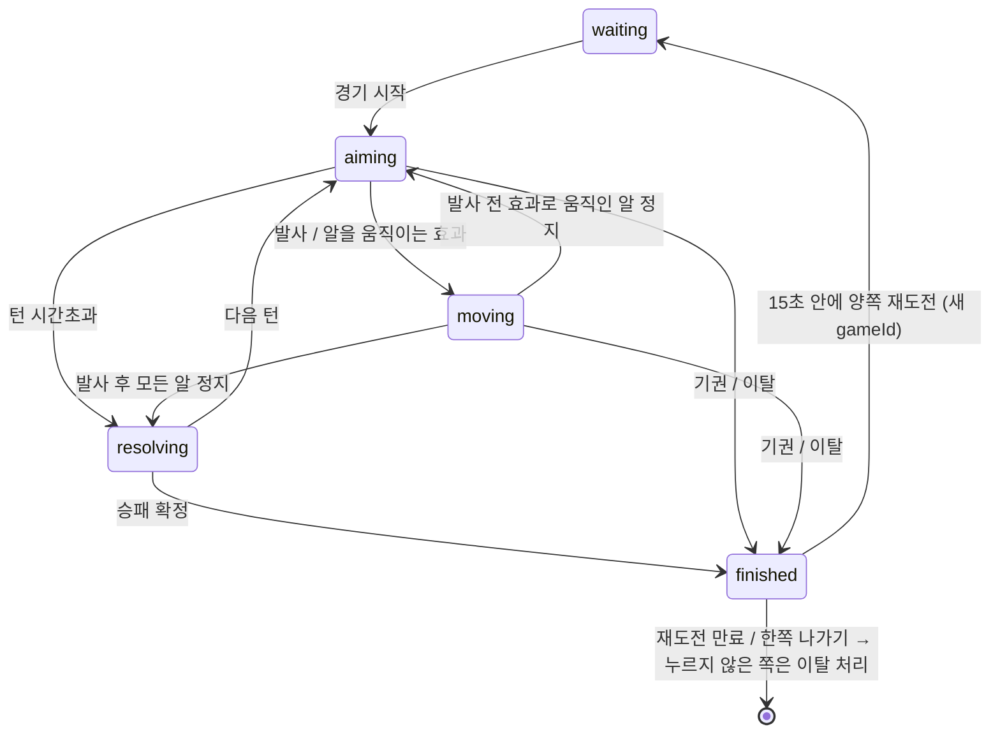

# 게임 처리·동기화 설계

## 상태

| 구분 | 상태 |
| --- | --- |
| 승인된 미구현 설계 | 아래 핵심 설계 원칙 ([DEC-013](../DECISIONS.md#결정-색인), [ADR-0003](../adr/0003-tech-stack-and-architecture.md)) |
| 현재 구현 | `game-core`의 규칙·물리·상태 머신·방해요소·`getViewFor`([IMPL-002](../TASKS.md#impl-002-game-core), PR 병합 전). 수치는 제안값 그대로이며 플레이 테스트 전 |
| 확정 (GAME-001 완료) | 아래 상태 전이·상세 계약. API-001 담당자(개발자 B) 검토 질문에 대한 답변을 [DEC-026](../DECISIONS.md#결정-색인)으로 반영 |
| 제안 (GAME-002) | 아래 기술 초기값. 플레이 테스트 전 구현 시작용 |
| 미정 | 아래 제품 해석·후속 항목 |

제품 규칙은 [게임](../PRD.md#게임-규칙)·[방해요소](../PRD.md#방해요소-규칙), 화면 동작은 [UI](../PRD.md#화면별-요구사항)를 따른다. 선택 이유·절충은 [ADR-0003](../adr/0003-tech-stack-and-architecture.md)에 있다.

## 핵심 설계 원칙 (승인)

1. **서버 권한 (Server Authoritative)**: 물리 계산, 승패 판정, 턴 타이머, 방해요소 지급·발동, 종료 시 전적 갱신은 서버에서만 한다. 클라이언트가 보낸 결과는 신뢰하지 않는다.
2. **실시간 진행 (승인)**: [DEC-015](../DECISIONS.md#결정-색인)의 이동 중 방해요소 사용을 지원하기 위해 서버가 고정 스텝으로 물리를 진행하고 현재 상태를 계속 전송한다. 클라이언트는 받은 상태를 보간해 표시한다. 기존 기록 후 재생 선택은 [ADR-0004](../adr/0004-realtime-hazards.md)로 대체됐다. 상세 이벤트 계약은 API-001에서 정한다.
3. **물리**: 판 평면의 2D 원 충돌을 직접 구현하고, [알 떠오름](../PRD.md#알-떠오름)은 알마다 높이 값을 따로 계산한다. 높이가 0보다 큰 알은 충돌 판정에서 빠지고, 착지할 때 판 안·밖을 판정한다. 렌더링은 클라이언트의 3D 계층에 한정한다.
4. **게임 로직 분리**: 게임 규칙, 물리, 턴 진행, 방해요소 적용은 `game-core` 패키지에 **순수 TypeScript**로 작성한다. Express, Socket.IO, DB, DOM, Three.js를 참조하지 않는다. 시간과 난수도 외부에서 주입받아(시드 기반 난수) 같은 입력이면 같은 결과가 나오게 하고, 단독으로 테스트할 수 있어야 한다. 로컬 모드와 서버가 이 패키지를 그대로 공유한다. 경계는 ESLint `no-restricted-imports`로 강제한다.
5. **데이터 기반 방해요소와 판**: 방해요소 메타데이터(id, 이름, 분류, 효과, 지속, 수치)와 판 정의는 `shared`에 데이터로 둔다. 판·알·입력에 개입하는 동작은 `game-core`의 시뮬레이션 훅과 상태 머신으로 구현한다.
6. **플레이어별 뷰 (비공개 정보)**: `game-core`는 상태를 그대로 내보내지 않고 `getViewFor(playerId)`로 플레이어별 뷰를 만든다. 상대에게 보내는 뷰에는 내 보유 방해요소의 종류·개수를 넣지 않는다. 시야 방해(후레쉬·물총)는 대상 플레이어 뷰에만 "가림 효과" 상태로 넣는다.
7. **휘발성과 영구 데이터 분리**: 경기 진행 상태(알 위치·턴·방해요소)는 서버 메모리, 방 정보(`rooms`)·회원·전적·세션은 DB ([DEC-023](../DECISIONS.md#결정-색인)).

## 기술 초기값 (조정 대상)

아래는 GAME-002가 제안한 **구현 시작용 기본값**이다. 승인된 확정값이 아니며 플레이 테스트로 조정한다(아래 [수치 변경 절차](#수치-변경-절차)). 길이 단위는 [판](../PRD.md#판-board)의 1단위 = 1cm, 시간은 실제 초다. 제품 수치(라운드·턴 시간·판·알 크기·효과 지속 시간)는 PRD를 따르고 여기서 바꾸지 않는다. 값은 구현 시 `shared`의 데이터 한 곳에 두고 `game-core`가 읽는다.

### 물리

| 항목 | 초기값 | 근거 |
| --- | --- | --- |
| 시뮬레이션 간격 | 고정 1/120초 | 승인([DEC-016](../DECISIONS.md#결정-색인)) |
| 지면 감속(마찰) | 일정 감속 100 cm/s² (속도 방향 반대) | 실제 바둑알보다 미끄럽게 잡아 이동을 눈으로 따라갈 수 있게 한다. 최대 세기 이동이 약 1.2초 |
| 최대 발사 속도 v_max | 117 cm/s | 감속 100에서 정지 거리 약 69cm = 판 한 변(46)의 1.5배. 기존 기준 "판 한 변 이상 이동"을 만족 |
| 세기 → 속도 | v(p) = v_max × √(p/100), p는 0 초과 100 이하(0은 발사하지 않음, [API](API.md#경기-이벤트-필드)) | 정지 거리가 세기에 비례(p 50 → 약 34cm)해 세기 막대를 직관적으로 읽을 수 있다 |
| 떠오름 높이 | p ≥ 80일 때 H(p) = 4.4 × (p − 79) / 21 cm, p < 80이면 0 | PRD의 "세기 80 이상이면 떠오름"과 최대 높이 알 지름 2배(4.4)를 선형으로 잇는다. 문턱 80에서도 높이가 0보다 커야 해서(H(80) ≈ 0.21) 시작점을 79로 둔다 |
| 중력 | 981 cm/s² | 실제 값. 최대 높이에서 체공 약 0.19초, 체공 중 수평 이동 최대 약 22cm. 체공 중에는 지면 감속을 적용하지 않는다 |
| 반발계수(알–알) | 0.9 | 기존 초기값 유지 |
| 반발계수(알–벽) | 0.7 | 벽에 맞으면 알끼리보다 덜 튕기게 해 벽 뒤 공간을 지키는 역할을 살린다 |
| 터널링 | 한 스텝 최대 이동 v_max/120 ≈ 0.98cm < 알 반지름 1.1cm | 이산 충돌로도 통과가 생기지 않는다. swept 충돌은 안전장치로 유지 |
| 시뮬레이션 종료 | 모든 알의 속도가 0.11 cm/s(알 반지름/초 × 0.1) 미만인 상태가 0.3초 지속 | 기존 초기값 유지 |
| 시뮬레이션 최대 시간 | 10초, 초과 시 모든 알 강제 정지 | 기존 초기값 유지. 최대 세기 단독 이동은 약 1.2초 |
| 판 이탈 판정 | 알 중심이 판 영역 밖이면 제거. 부동소수 비교 허용 오차 1e-6cm | 판 돌리기·책상 흔들기로 옮긴 알은 경계에서 0.01cm 안쪽으로 보정해 이 효과로 떨어지지 않게 한다 |

### 방해요소 수치

제품 규칙의 해석은 [DEC-031](../DECISIONS.md#결정-색인)을 따른다. 쿨타임은 실제 시간(초)으로 세고, 피로도 게이지는 과열 방식이다.

| 항목 | 초기값 | 근거 |
| --- | --- | --- |
| 지급 추첨 | 18종에서 그 좌석의 직전 종류를 뺀 17종 균등, 좌석별 독립 스트림 | [DEC-055](../DECISIONS.md#결정-색인). 등장 확률 밸런스는 플레이 테스트 후 조정 |
| 피로도 게이지 | 0~100. 사용할 때마다 비용만큼 오른다. 100에 닿으면 **과열**되어 0이 될 때까지 피로도 게이지형을 쓸 수 없다. 과열 전에는 남은 양과 관계없이 사용할 수 있다 | DEC-031 |
| 피로도 감소 | 초당 5, 항상 감소(과열 중 포함) | 과열 후 0까지 20초. 초당 10이면 후레쉬(비용 40, 2초)를 4초마다 계속 쓸 수 있어 상대 화면이 거의 늘 가려진다 |
| 피로도 비용 | 판 돌리기 25, 후레쉬 40, 물총 45, 책상 흔들기 40 | 판 돌리기는 쉬지 않고 쓰면 4번째 사용에서 과열([DEC-039](../DECISIONS.md#결정-색인)으로 50에서 절반), 나머지는 2~3번째. 감소량으로 나눈 지속 사용 간격은 판 돌리기 5초, 후레쉬 8초, 물총 9초, 책상 흔들기 8초 |
| 쿨타임 | 벽 20초, 끈끈이 20초, 기절 30초. 사용 시점부터 셈 | 모두 효과 지속(8·8·4초)보다 길어 같은 효과가 겹치지 않는다. 기절은 30초 턴 안에 두 번 걸리지 않게 턴 시간 이상으로 둔다 |
| 바람 방향 변경 | 지급 즉시 상시 효과를 만들고 방향은 [2, 4]초 균등 간격마다 판 좌표계 [0°, 360°) 균등으로 바꾼다. 변경은 효과를 끝내지 않고 상태 revision만 올린다 | [DEC-038](../DECISIONS.md#결정-색인)(DEC-031의 15초 구간 발동 대체). 시드 난수(지급 번호별 스트림) |
| 판 돌리기 | 판 중심 기준 시계 방향 45°(위에서 볼 때), 회전 연출 1초 | PRD 45°. 방향은 매번 같게 해 예측할 수 있게 한다 |
| 후레쉬 | 4초. 손 위치(좌석 기준점에서 판 쪽 8cm·높이 12cm)에서 조준점 방향으로 반각 10° 원뿔. 상대 얼굴(상대 좌석 기준점, 높이 24cm)이 원뿔 안이면 가림이 초당 0.8(최대 면적 대비)씩 오르고, 밖이면 초당 0.5씩 준다. 가림 면적 최대 70%. 가림은 매 틱 계산하고 뷰 revision은 0.05 이상 바뀌거나 0·1에 닿을 때만 올린다. 조준점 없이 발동하면 빗나감으로 시작 | [DEC-036](../DECISIONS.md#결정-색인). 발동 순간부터 조준을 옮겨 얼굴에 맞혀야 효과가 커진다 |
| 물총 | 5초. 후레쉬와 같은 판정(물줄기). 물방울 자국 가림 최대 70% | [DEC-036](../DECISIONS.md#결정-색인) |
| 책상 흔들기 | 알마다 독립으로 방향 [0°, 360°) 균등, 거리 [0, 2.2]cm 균등. 이동 후 겹친 알은 서로 밀어 겹침을 푼다. 흔들림 연출 0.5초 동안 양쪽 화면·조준 흔들림 | [DEC-036](../DECISIONS.md#결정-색인) "알 지름 1배 이내" |
| 벽 | 길이 13.2cm(알 지름 6배), 두께 0.6cm, 15초([DEC-067](../DECISIONS.md#결정-색인)). 중심은 판 중심에서 2.2cm(알 지름) 간격 격자에 스냅. 방향은 가로·세로 두 가지 | [DEC-036](../DECISIONS.md#결정-색인). 방향 입력은 [LOCAL 방해요소 입력](LOCAL.md#방해요소-입력) |
| 벽과 떠 있는 알 | 떠 있는 알(h > 0)은 벽과도 충돌하지 않는다 | 떠 있는 알이 다른 알과 충돌하지 않는 규칙과 맞춘다 |
| 끈끈이 | 지름 13.2cm 원, 15초([DEC-067](../DECISIONS.md#결정-색인)). 안에 있는 지면 알에 추가 감속 900 cm/s²(기본 감속과 합쳐 1000) | [DEC-036](../DECISIONS.md#결정-색인) "효과 강화" |
| 기절 | 4초. 조준·발사·기본 판 돌리기 불가 | [DEC-036](../DECISIONS.md#결정-색인) |
| 세기 막대 속도 조절 | 보유 중 상대 막대 속도 3배(기본 왕복 1초 → 약 0.33초) | [DEC-039](../DECISIONS.md#결정-색인)(2배에서 1.5배 강화) |
| 바람 | 보유 중 상시, 조준 방향을 바람 방향 쪽으로 초당 30° 회전하고 화면을 흔든다 | [DEC-038](../DECISIONS.md#결정-색인). 상시 적용이라 DEC-036의 초당 120°에서 낮춘 제안값 |
| 손이 닿는 거리 | 좌석 기준점(판 중심에서 자기 쪽으로 30cm)에서 알 중심까지 26cm 이하는 편안, 40cm 초과는 발사 거부(`OUT_OF_REACH`). 26~40cm는 조준 흔들림 세기를 0→1로 키운다(클라이언트 표시·조준 입력만, 서버는 거리만 검증) | [DEC-036](../DECISIONS.md#결정-색인). 기본판에서 내 쪽 알은 편하게, 판 중앙 너머 먼 알은 판을 돌려야 닿는다 |
| 기본 판 돌리기 | 내 턴·`aiming`·기절 아님에서만. 최대 초당 90°, 명령마다 \|Δ\| ≤ 속도×경과 시간 + 15° 여유(넘으면 한도까지 잘라 적용). 판 돌리기 방해요소와 같은 방식으로 알·벽·끈끈이를 함께 돌리고 알을 판 안에 유지 | [DEC-036](../DECISIONS.md#결정-색인). 시안의 회전 속도(약 86°/s) |

### 전송·실행

| 항목 | 초기값 | 근거 |
| --- | --- | --- |
| 알 이동 중 스냅샷 | 초당 30회, volatile | 기존 30fps 샘플링 기준. 측정 후 조정(OPS-001) |
| 조준 중 상태 | 바뀔 때만 전송 | DEC-026 |
| 클라이언트 보간 지연 | 100ms(스냅샷 3개) | 전송 1회 유실을 버틴다 |
| 틱 따라잡기 상한 | 한 번에 최대 0.25초(30스텝). 넘는 지연은 버리고 로그에 남긴다 | 서버 멈춤 뒤 한꺼번에 계산하다 더 밀리는 것을 막는다 |

### AI 대전

| 항목 | 초기값 | 근거 |
| --- | --- | --- |
| 조준 시간 | 턴 시작 후 1.5~3.0초 균등 | 사람처럼 보이게 하고 30초 마감과 멀다 |
| 조준 오차 | 각도 정규분포 σ 4°, 세기 균등 ±8(1~100으로 자름) | 1단계(보통). 가까운 알은 대부분 맞히고 먼 알은 자주 빗나간다 |
| 방해요소 사용 | 사용 가능할 때 사람(상대) 턴 시작 후 1~8초 중 무작위 시각(턴 마감 1초 전까지). 랜덤형(바람·세기 막대)은 직접 쓰지 않는다. 벽·끈끈이는 자기 알에서 가장 가까운 상대 알 쪽 빈 자리(벽은 격자 스냅, 그 방향을 가로막는 방향) 후보 중 무작위. 후레쉬·물총은 상대 얼굴 쪽(오차 σ 1.2cm)으로 1.5~3.5초 유지 후 놓는다. 판 돌리기 방향은 무작위. 추가 10종([DEC-063](../DECISIONS.md#결정-색인), [IMPL-016](../TASKS.md#impl-016-방해요소-10종-추가와-턴-교체)): 위치형은 배치 가능한 후보(벽 계열은 격자, 나머지는 2.2cm 간격 격자) 중 균등 무작위, 중력 구역·벽 계열 방향도 무작위, 분신술은 내 멈춘 알 중 무작위, 알 무게는 바로 사용(미끄럼 장판은 [DEC-071](../DECISIONS.md#결정-색인)로 위치형이 돼 같은 무작위 위치 규칙을 쓴다). 후보가 없으면 그 시각에는 쓰지 않는다 | [DEC-042](../DECISIONS.md#결정-색인)·[DEC-055](../DECISIONS.md#결정-색인) |
| 발사 선택 | 손 닿는 내 알 × 상대 알 방향 × 세기 20·30·45·60·70을 같은 물리(`previewShot`)로 미리 돌려 점수(상대 알 +10, 내 알 −12, 가장자리 근접도)를 매기고, 상위 12개는 조준 오차 표본(각도 0·±σ·±2σ, 세기 ±8)의 평균으로 다시 고른다. 기대 점수 6 미만이거나 칠 알이 없으면 판 돌리기(±45·±90·180°, 45°당 −1.5점, 한 턴 최대 2회, 남은 시간 6초 이상)도 본다 | 1단계 체감 조정 대상. 25경기 표본에서 기본판 발사당 상대 알 0.37·내 알 0.15개([worklog](../worklogs/2026-11-02.md#impl-005-ai-대전)) |

### 수치 변경 절차

1. [VAL-001](../TASKS.md#val-001-성능-측정-절차와-플레이-테스트-기록-양식)의 플레이 테스트 기록 양식으로 바꿀 수치와 관찰 결과를 날짜별 worklog에 남긴다.
2. 바꿀 값과 근거(관찰·대안)를 [DECISIONS](../DECISIONS.md)에 새 DEC로 기록한다. 제품 수치(PRD에 적힌 값)를 바꾸면 PRD도 같은 변경에서 고친다.
3. 이 절의 표와 `shared`의 수치 데이터를 같은 변경에서 고친다. 값이 승인되면 표의 근거 칸에 DEC 번호를 적는다.

## 상세 계약 초안 (GAME-001)

아래는 개발자 A의 검토안이다. [DEC-014·015](../DECISIONS.md#결정-색인)의 제품 규칙은 승인됐으며, 실시간 계산 방식은 DEC-016, 개발자 B 검토에 따른 명령·종료·전송 경계는 DEC-026으로 승인됐다. 이벤트 이름·필드는 API-001에서 확정한다. 선계산과 재생을 분리한 이전 초안은 이동 중 새 입력을 처리할 수 없어 이 초안으로 교체했다.

### 상태 전이와 순서

게임의 주 상태와 방해요소 효과는 별도로 관리한다. 방해요소 사용은 전용 게임 상태가 아니라 현재 상태에 효과를 추가하는 입력이다.

| 경기 상태 | 방 상태(`rooms.status`) | 비고 |
| --- | --- | --- |
| 시작 커밋 전 | waiting | 대기실. 이탈은 대기실 처리, 전적 미반영 |
| waiting(경기 생성)·aiming·moving·resolving | playing | 시작 커밋 이후. 이탈은 기권패 |
| finished, 재도전 대기 15초 | playing | 결과 화면. 이 구간의 나가기는 기권이 아니며 결과도 바꾸지 않음 |
| 재도전 성립 | playing 유지 | 같은 방·같은 설정으로 새 경기 생성 |
| 재도전 만료·한쪽 나가기 | waiting(방장만 남은 경우) 또는 방 삭제 | 재도전하기를 누르지 않은 쪽은 나가기와 같게 처리한다([DEC-041](../DECISIONS.md#결정-색인)). 상대가 나가면 방장만 남아 상대를 기다리고, 방장이 나가면 방이 닫혀 둘 다 방 목록으로 이동 |

- **시작 커밋**: 상대 입장([DEC-040](../DECISIONS.md#결정-색인))이 `rooms.status`를 waiting → playing으로 바꾼 직후, `game:start` 전송 직전이다. 시작 명령 이벤트는 없다. 방 큐와 `ingressSeq` 순번에 입장을 어떻게 올리는지는 IMPL-009에서 정한다. 이 시작 커밋보다 ingressSeq가 앞선 이탈은 대기실 처리, 뒤의 이탈은 기권패와 전적 반영 대상이다. 첫 틱은 기준으로 쓰지 않는다 ([DEC-026](../DECISIONS.md#결정-색인)).

| 상태 | 의미 | 방해요소 입력 |
| --- | --- | --- |
| waiting | 경기 시작 전 | 거부 |
| aiming | 현재 플레이어 조준, 알은 정지 | 양쪽 모두 허용. 제한·배치 검증 후 적용 |
| moving | 알이 움직이며 계산·화면 표시가 동시에 진행 | 양쪽 모두 허용. 다음 권한 틱에 효과 반영 |
| resolving | 같은 틱 안에서 종료·라운드·교체·다음 턴을 정리 | 외부 대기 단계가 아님. 큐 입력은 전이 후 상태에서 재검증 |
| finished | 확정 결과 표시 | 거부, 결과 불변 |

- `moving`은 계산 결과 재생 단계가 아니다. 발사 도중 벽 사용 → 다음 서버 틱에서 벽 생성 → 이후 알이 벽에 부딪힘 → 그 상태를 양쪽 화면에 전송한다. 이미 지나간 충돌 결과를 소급 변경하지 않는다.
- `turnContext`는 activePlayerId, turnId, round, deadlineMs, shotCommitted를 가진다. 주 상태와 별도로 effects에 후레쉬·벽 등 활성 효과를 둔다. 기절·시야 가림만으로 주 상태를 바꾸지 않는다.
- 조준 중 책상 흔들기로 알이 움직여도 자기 알 선택·조준·발사는 계속 허용한다. 알의 현재 위치를 기준으로 입력을 검증하고 발사하며, 턴 타이머는 계속 간다. 같은 틱의 흔들기와 발사는 ingressSeq 순서로 처리한다.
- 발사 결과 승패는 모든 알이 멈춘 뒤 전체 결과로 판정한다. 양쪽 0개면 무승부다. 판 돌리기·책상 흔들기 자체는 알을 판에서 제거하지 않는다. 이 효과 뒤에 계속된 물리 움직임의 제거는 발사 전체 결과로 판정한다.
- 턴 종료가 확정되면 completedTurns를 한 번 증가시킨다. 2턴마다 라운드가 끝난다. 종료 판정 → 필요한 방해요소 교체 → 다음 턴 주인 변경 → 회복·쿨타임·자동 발동 처리 → 플레이어별 뷰·turn:change 순이다. 교체는 발사 처리·시간초과로 라운드의 두 번째 턴이 끝날 때(completedTurns가 짝수가 될 때, [DEC-067](../DECISIONS.md#결정-색인)) 두 좌석 모두 보유 1개와 그 게이지·쿨타임·턴당 사용 기록·지속 효과·설치물을 지우고 새 방해요소로 교체한다(경기가 끝난 턴은 교체하지 않는다, [DEC-055](../DECISIONS.md#결정-색인)). 판·알에 이미 반영된 즉시 효과의 상태는 되돌리지 않는다.

### 명령 경합과 시간

- 방 단위 단일 큐에 서버 관찰 순번 ingressSeq와 단조 시각 observedAtMs를 붙인다. 재도전으로 새 경기가 시작돼도 순번을 0으로 되돌리지 않는다([OPERATIONS 서버 로그](OPERATIONS.md#서버-로그)). 같은 틱 입력은 순번대로 처리한다. 클라이언트 시각으로 과거 틱을 변경하지 않는다.
- 고정 틱마다 마감·효과 만료 정산 → 대기 명령 검증·적용 → 물리 적분·충돌·착지·제거 → 정지·종료 판정 → 플레이어별 상태 전송 순이다. 실제 시간과 물리 진행을 같은 권한 시간축에 맞추며 CPU 계산 완료 시간을 게임 경과로 삼지 않는다.
- 발사는 관찰 시각이 deadlineMs보다 작아야 한다. 정확히 마감이면 시간초과가 우선이다. 발사 시 해당 플레이어의 연속 시간초과를 0으로 만들고 턴 타이머는 끝낸다. 시간초과는 플레이어별 누적·강제 기권 조건을 PRD대로 적용한다.
- 방해요소는 발사 전후 모두 허용하므로 같은 틱에 발사가 먼저 처리돼도 방해요소를 단순히 moving이라는 이유로 거부하지 않는다. 종료·교체·제한 상태는 순서대로 재검증한다.
- commandId와 그 저장소는 두지 않는다 ([DEC-026](../DECISIONS.md#결정-색인)). 끊기면 기권패이고 재접속 복구가 없어 ack 유실 후 재전송이 생기지 않으며, Socket.IO는 한 연결 안에서 순서·중복이 없다. 응답은 ack 콜백으로 짝짓는다.
- 명령 검사 순서(첫 실패에서 멈춤)는 [AUTH 검증 경계](AUTH.md#검증-경계)의 2b단계를 따른다.
- 발사는 gameId·turnId로 검사하고 `shotCommitted`로 같은 턴의 두 번째 발사를 거부한다. 방해요소는 gameId·hazardInstanceId로만 검사해 교체 전 카드 명령을 거부한다. 방해요소는 상대 턴에도 쓸 수 있으므로 turnId로 거르지 않는다. 재도전 시 turnId가 다시 시작하므로 gameId로 이전 경기 명령을 구분한다. 오류 형식은 API-001에서 정한다.
- 이탈·기권·접속 대체(`session:replaced`, 비밀번호 변경으로 끊긴 연결 포함)도 같은 큐의 기권 명령으로 처리한다. 먼저 관찰된 이탈자를 기권패 처리하며 동시 시각은 ingressSeq로 구분한다. 시작 커밋 전 이탈은 대기실 처리다.
- `game-core`는 종료를 finished 결과로 돌려줄 뿐 저장하지 않는다. 서버가 finished 결과를 받아 `finishOnce`로 전적 갱신을 1회만 실행하고, 이후 결과를 바꾸지 않는다. 이름은 `finishOnce`로 통일한다(`settled`는 알 정지 훅 `onSettled`와 겹쳐 쓰지 않는다). 종료 사유는 DB에 저장하지 않고 서버 로그에만 남긴다.
- 로그는 턴 시작·발사·방해요소 사용/발동·이탈·종료 때만 남기고 틱마다 남기지 않는다. 필드는 경기·턴 ID, UTC·단조 시각, ingressSeq, serverTick, 명령 종류·판정 결과에 userId·roomId·종료 사유를 더한다. 비공개 보유 상태·세션·쿠키는 기록하지 않는다. 이벤트 이름과 판정 방법은 [OPERATIONS 서버 로그](OPERATIONS.md#서버-로그)에서 정했다.
- 초 단위 효과는 expiresAtMs까지 유지한다. 조준과 이동 사이에서 타이머를 새로 시작하거나 중복 차감하지 않는다. 서버 지연 시 따라잡기 틱 수·전송 주기·클라이언트 보간 지연은 측정 후 기술값으로 정한다.

### 상태 위치와 플레이어별 뷰

| 위치 | 필드 |
| --- | --- |
| 경기 내부 | phase, serverTick, revision, turnContext, completedTurns, board, stones(좌표·높이·속도), effects, result, 독립 PRNG 스트림 |
| 본인 비공개 | heldHazard(instanceId·kind·교체 라운드), 현재 방해요소의 피로도 게이지·과열 여부·쿨타임 만료 시각, timeoutStreak |
| 공개 GameView | gameId, serverTick, serverNowMs, revision, phase, turnId, round, activePlayerId, deadlineMs, 판 변환, 알(id·ownerId·x·y·h), 공개 활성 효과·발동 안내, 확정 결과 |
| 본인 private | heldHazard, 게이지·쿨타임·사용 가능 여부, 내 연속 시간초과, 대상 화면 가림 |

본인 private의 게이지·쿨타임 필드 이름은 다음과 같다([API-002](../TASKS.md#api-002-api-이름식별자-확인과-private-뷰-필드-확정), API의 [`GameView.private`](API.md#경기-이벤트-필드)와 같다).

| 필드 | 값 | 의미 |
| --- | --- | --- |
| `fatigueGauge` | 0~100 또는 `null` | 피로도 게이지형(판 돌리기·후레쉬·물총·책상 흔들기)을 보유했을 때 `serverNowMs` 시점의 게이지. 다른 분류면 `null`. 초당 감소량은 `shared`의 수치 데이터에 있으므로 클라이언트가 다음 상태까지 이 값에서 이어 계산해 표시한다 |
| `overheated` | 불리언 | 피로도 게이지형이 과열(게이지 100에 닿은 뒤 0이 되기 전) 상태인지. 다른 분류면 `false` |
| `cooldownEndsAtMs` | epoch ms 또는 `null` | 쿨타임형(벽·끈끈이·기절)을 쓴 뒤 다시 쓸 수 있게 되는 시각. 쿨타임 중이 아니거나 다른 분류면 `null` |
| `usable` | 불리언 | 지금 사용 입력이 분류 제한(과열·쿨타임·랜덤형)에 막히지 않는지. 랜덤형(`bar_speed`·`wind`)은 직접 쓰지 못하므로 항상 `false`다. 위치 검증(`HAZARD_INVALID_TARGET`)은 반영하지 않는다 |

`getViewFor(playerId)`는 허용 목록으로 새 객체를 만든다. 상대 보유 종류·교체 추첨 결과·게이지·쿨타임·난수 시드는 보내지 않는다. 보유 개수도 별도 전송하지 않는다. 사용된 효과의 이름과 효과는 양쪽 공개하고 화면 가림 표현은 대상 뷰에만 담는다.

`playerId`·`ownerId`·`activePlayerId`는 경기 안의 좌석 값 0·1이며 뷰에 `users.id`를 넣지 않는다. 서버만 좌석과 `users.id`를 매핑해 전적을 저장한다([DEC-030](../DECISIONS.md#결정-색인)).

### 방해요소별 처리

직접 사용형은 aiming과 moving 양쪽에서 처리한다. 방해요소 효과는 턴 마감·턴 변경과 독립이다. 30초 마감은 효과와 관계없이 그대로 처리하고, 효과는 마감·턴 변경 뒤에도 자기 지속 시간만큼 유지된다. 효과·보유가 초기화되는 시점은 교체뿐이며, 교체는 라운드가 바뀔 때마다 일어나므로 효과는 그 라운드 안에서만 남는다([DEC-031](../DECISIONS.md#결정-색인)·[DEC-055](../DECISIONS.md#결정-색인)·[DEC-067](../DECISIONS.md#결정-색인)). 슬롯은 1개이며 비용·쿨타임 검증에 실패한 입력은 상태와 난수를 바꾸지 않는다. 효과별 대상과 제한의 미정 항목은 아래를 따른다.

| 종류 | 적용 훅·상태 |
| --- | --- |
| 판 돌리기 | 기본 판 돌리기의 상대 턴 제한과 독립적으로 보유 중 언제든 사용. 판·알 좌표 회전 후 알을 판 안에 유지. 알의 속도 벡터·벽·끈끈이의 위치와 방향도 같은 각도로 회전. 카메라는 고정 |
| 후레쉬 | 대상 뷰에 만료 시각을 가진 화면 가림 추가, 물리에는 영향 없음 |
| 물총 | 대상 뷰에 별도 가림 추가, 물리에는 영향 없음 |
| 책상 흔들기 | 시드 난수로 현재 알 위치 이동. 결과 좌표는 판 안으로 보정하고 이 효과 자체로 제거하지 않음. 흔들리는 중에도 조준·발사 허용 |
| 벽 | 판 좌표계의 격자 후보 중심과 방향으로 배치. 판 밖·알·기존 벽·끈끈이와 겹치면 거부. 이후 틱 충돌에 반영. 떠 있는 알과의 접촉 규칙은 물리 설계에 따름 |
| 끈끈이 | 원 영역 추가, 지면 알의 적분 전 감속 적용 |
| 기절 | 사용자의 턴과 관계없이 상대의 조준·발사 입력 차단·만료 시각 관리. 이미 움직이는 알을 멈추거나 발사를 취소하지 않음 |
| 세기 막대 속도 조절 | 보유 중 상대에게 상시 적용하며 교체 때 해제한다. 서버는 효과 배율을 알리고 클라이언트가 보유 기간 동안 적용한다. 조준하지 않으면 조작 변화 없음 |
| 바람 | 보유 중 턴과 관계없이 상대에게 상시 적용하고 교체 때 해제한다. 서버는 지급 때 `hazard:triggered`(start)를 한 번 보내고, 방향 변경은 뷰의 효과 `params.directionRad` 갱신으로 알린다. 클라이언트가 상대의 조준 방향에 자동 편향을 더함. 상대가 조작하지 않아도 방향이 움직임. 알의 속도·좌표에는 영향 없음 |

조준 방향·세기 막대 값은 서버 권한 상태가 아니다 ([DEC-026](../DECISIONS.md#결정-색인)). `aim:update` 같은 조준 전송 이벤트는 두지 않는다. 클라이언트가 바람·세기 막대 효과를 반영한 최종 각도·세기를 `shot:submit`으로 보내고, 서버는 값 범위·알 소유·기절·마감·turnId를 검증한다. 조작된 클라이언트가 바람 편향을 무시해도 서버는 알 수 없다. 랭킹·레이팅이 없는 MVP에서는 이 위험을 감수한다. 상대 조준선을 실시간으로 보여주는 요구가 생기면 다시 검토한다.

### 추가 방해요소 10종과 턴 교체 (HAZ-001)

상태: [DEC-055](../DECISIONS.md#결정-색인)·[DEC-057](../DECISIONS.md#결정-색인)의 상세 계약이며 [DEC-063](../DECISIONS.md#결정-색인)으로 확정했고 [IMPL-016](../TASKS.md#impl-016-방해요소-10종-추가와-턴-교체)에서 구현했다. 아래 수치는 모두 플레이 테스트 전 제안값이며 [수치 변경 절차](#수치-변경-절차)로 확정한다. 길이는 알 지름 2.2cm의 배수로 잡았다.

**라운드 교체.** 발사 처리(`resolved`)·시간초과(`timeout`)로 라운드의 두 번째 턴이 끝날 때(두 좌석이 한 번씩 쏜 뒤) 두 좌석 모두 교체한다([DEC-067](../DECISIONS.md#결정-색인)). 라운드의 첫 턴이 끝날 때는 교체하지 않고 보유·효과·게이지·쿨타임·턴당 사용 기록이 이어진다. 순서는 [상태 전이](#상태-전이와-순서)의 "종료 판정 → 교체 → 다음 턴 주인 변경 → 뷰·`turn:change`"를 그대로 쓰며, 교체는 두 좌석의 효과·설치물·게이지·과열·쿨타임·턴당 사용 기록을 지운 뒤 새로 뽑는다. 추첨은 18종에서 그 좌석의 직전 종류를 뺀 17종 균등이고, 좌석별 독립 시드 스트림을 쓴다. 경기 종료 판정이 난 턴에는 교체하지 않는다. 판 돌리기·후레쉬·물총·바람·세기 막대도 같은 시점에 끝난다(바람·세기 막대의 `end` 발동 안내를 보낸다).

**분류.** `HazardCategory`에 `per_turn`(턴당 1회)을 더한다. 턴당 1회형은 지급된 턴에 한 번 쓰면 `usable=false`가 되고 다음 교체까지 다시 쓸 수 없다. 거부 코드는 기존 `HAZARD_NOT_USABLE`이다. 게이지·쿨타임 필드는 `null`이다.

| 종류 (`HazardKind`) | 분류·지속 | 상태 위치 | 적용 훅 |
| --- | --- | --- | --- |
| 자석 `magnet` | 쿨타임 20초·15초 | 공개 효과 `{x, y}` | `beforeIntegrate`: 영향 원 안의 **움직이는 지면 알**(속도 ≥ 정지 판정 속도, h = 0)과 **떠 있는 알**(h > 0)에 자석 중심 쪽 가속을 더한다. 멈춘 지면 알은 제외([DEC-067](../DECISIONS.md#결정-색인)) |
| 중력 구역 `gravity_zone` | 쿨타임 20초·15초 | 공개 효과 `{x, y, directionRad}` | `beforeIntegrate`: 정사각 구역 안의 움직이는 지면 알과 떠 있는 알에 `directionRad` 방향 가속을 더한다. 멈춘 지면 알은 제외([DEC-067](../DECISIONS.md#결정-색인)) |
| 미끄럼 장판 `ice_floor` | 턴당 1회·13초 | 공개 효과 `{x, y}`(원형 영역, [DEC-071](../DECISIONS.md#결정-색인)) | `beforeIntegrate`: 원 안의 지면 알에만 지면 감속 배율을 곱한다. 다른 설치물과 겹칠 수 없어 끈끈이 영역과 동시에 걸리지 않는다 |
| 분신술 `decoy` | 턴당 1회·교체까지 | 경기 내부 `decoys[{ decoyId, ownerSeat, x, y }]`, 진짜 알 좌표는 기존 `stones` | 사용 시 고른 내 알과 허상 2개를 무작위 3자리에 둔다(진짜 자리는 시드 난수로 섞음). `onContact` 전에 지면 알과 허상의 겹침을 검사해 닿은 허상만 지운다. 허상은 충돌·판 이탈·남은 알 수·승패·손 닿는 거리 판정에 들어가지 않는다 |
| 가짜벽 `fake_wall` | 쿨타임 20초·15초 | 경기 내부 벽 3개 `{ x, y, angleDeg, real }`. `real`은 경기 내부에만 두고 어느 뷰에도 넣지 않는다 | 진짜 1개만 기존 벽 충돌에 넣는다. 가짜 2개는 표시만 한다. 지정한 자리는 진짜 벽이고, 가짜 2개의 자리는 시드 난수로 고른다. 세 벽의 생성·발동·종료 시각은 같다(DEC-066) |
| 알 무게 변화 `heavy_stones` | 턴당 1회·교체까지 | 경기 내부 `massMultiplier[seat]` | `onContact`: 알–알 충돌을 질량비 반영 식으로 바꾼다(반발계수 0.9 유지). 벽·판 이탈·발사 속도에는 영향 없음 |
| 방향 반전 구역 `reverse_zone` | 쿨타임 20초·15초 | 공개 효과 `{x, y}`, 내부 `reversedStoneIds` | `afterStep`: 움직이는 지면 알의 중심이 원 안으로 처음 들어온 스텝에 속도 벡터를 −1배 한다. 같은 알·같은 구역은 한 번만 |
| 폭탄 `mine` | 턴당 1회·터질 때 또는 교체까지 | 공개 효과 `{x, y}` | `onContact`: 움직이는 지면 알이 폭탄에 닿으면 폭발 반경 안의 지면 알(멈춘 알 포함)에 바깥쪽 속도를 더하고 효과를 `end`로 끝낸다. 터진 뒤 정지 판정이 다시 시작된다 |
| 바닥 없어지기 `pit` | 쿨타임 20초·15초 | 공개 효과 `{x, y}` | `onExit`: 지면 알의 중심이 구멍 원 안이면 판 이탈과 같게 제거한다. 떠 있는 알은 착지 지점으로 판정한다 |
| 이동 장애물 `moving_wall` | 쿨타임 20초·15초 | 공개 효과 `{x, y, orientation}`, 위치는 `startsAtMs`로 계산 | 매 틱 왕복 위치를 계산하고 **움직이는 지면 알**과만 충돌한다(벽 속도를 뺀 상대 속도로 반사, 반발계수 0.7). 멈춘 알은 통과하며 밀지 않는다 |

공통 규칙:

- 위치형(자석·중력 구역·미끄럼 장판·가짜벽·방향 반전·폭탄·구멍·이동 장애물)은 판 좌표계 좌표를 받고, 벽 계열(가짜벽·이동 장애물)은 기존 벽 격자에 스냅한다. 설치물의 차지 영역(아래 표의 크기, 이동 장애물은 왕복 경로를 쓸고 지나간 직사각형)이 판 밖으로 나가거나 다른 설치물(벽·끈끈이 포함)과 겹치면 `HAZARD_INVALID_TARGET`이다(DEC-057). 알과의 겹침은 벽·가짜벽 세 개 모두·폭탄·구멍만 거부하고, 영역형(자석·중력·반전·끈끈이·미끄럼 장판)과 이동 장애물 경로는 허용한다.
- [DEC-066](../DECISIONS.md#결정-색인): 가짜벽의 지정 위치는 진짜 벽이다. 나머지 두 가짜벽은 알·다른 설치물·서로를 피하는 무작위 자리로 동시에 생성한다. 세 벽의 효과는 모두 준비된 뒤 한 번에 추가하며 빈 자리 부족이면 상태·난수를 바꾸지 않고 거부한다. 분신술 자리는 벽(가짜 포함)·구멍과도 겹치지 않게 고른다. 중력 구역 효과 `params.angleDeg`로 판 돌리기 뒤에도 화면·배치 판정에 같은 영역을 쓴다.
- 중력 구역의 방향 화살표는 배치 미리보기·설치 뒤 모두 판 평면 위에 평평하게 그린다([DEC-071](../DECISIONS.md#결정-색인)). 판 돌리기 뒤에는 `angleDeg`와 `directionRad`로 같은 평면에서 다시 그린다.
- 판 돌리기(방해요소·기본)는 새 설치물의 좌표·`directionRad`·벽 각도·허상 좌표도 같은 각도로 회전한다. 이동 장애물의 왕복 축도 함께 회전한다.
- 분신술 대상은 내 알 중 **멈춘 지면 알**이어야 한다(아니면 `HAZARD_INVALID_TARGET`). 허상·진짜 자리를 만들 빈 자리가 없거나 위치 추첨이 실패하면 거부하며, 이때 추첨에 쓴 난수 스트림 상태를 되돌려 "실패한 입력은 상태와 난수를 바꾸지 않는다"를 지킨다.
- 같은 시드·같은 명령이면 결과가 같아야 하므로 허상 자리·가짜벽 두 자리·추첨은 모두 지급 번호별 시드 스트림을 쓴다.

수치 제안값:

| 항목 | 제안값 | 근거 |
| --- | --- | --- |
| 지급 추첨 | 18종 균등, 직전 종류 제외(17종 중 1) | DEC-055 |
| 자석 | 영향 원 반지름 8.8cm(알 지름 4배). 범위에 닿은 알은 블랙홀처럼 빨려 든다: 중심 쪽 속도에 5400 cm/s² 가속을 더하고, 비껴가는(중심과 수직인) 속도는 초당 12배 비율로 줄이며, 중심을 지나칠 스텝이면 중심에 세운다 | 180에서 3배([DEC-067](../DECISIONS.md#결정-색인)) 뒤 블랙홀식 흡입으로 변경([DEC-068](../DECISIONS.md#결정-색인)). 상수 `magnetAccel`·`magnetTangentDamping`. 떠 있는 알에도 적용하고 멈춘 지면 알은 제외한다 |
| 중력 구역 | 한 변 13.2cm 정사각(끈끈이 지름과 같음), 가속 450 cm/s², 방향은 45° 단위 8방향 | 방향 8개는 [DEC-058](../DECISIONS.md#결정-색인) 승인. 가속은 150에서 3배([DEC-067](../DECISIONS.md#결정-색인)), 떠 있는 알에도 적용 |
| 미끄럼 장판 | 지름 26.4cm 원(끈끈이 지름 13.2cm의 2배). 원 안 지면 감속 ×0.4(100 → 40 cm/s²) | 판 전체에서 설치형으로 바꿨다([DEC-071](../DECISIONS.md#결정-색인)). 원 안에서만 덜 멈춰 멀리 미끄러진다 |
| 분신술 | 원래 자리에서 4.4~11cm(알 지름 2~5배) 안의 빈 자리 3곳. 서로·다른 알과 중심 거리 3.3cm 이상, 판 경계에서 2.2cm 안쪽. 후보 시도 최대 64회 | 상대가 원래 자리로 진짜를 추정하기 어렵게 거리를 둔다 |
| 가짜벽 | 기존 벽과 같은 크기 3개. 클릭한 격자 위치가 진짜이고 나머지 두 자리를 같은 방향의 배치 가능한 격자 후보에서 시드 난수로 고른다(DEC-066) | 한 번 클릭으로 3개를 놓는 규칙 |
| 알 무게 변화 | 내 알 질량 ×3 | 같은 세기로 맞아도 밀리는 속도가 절반으로 준다(질량 1 대 3 충돌) |
| 방향 반전 구역 | 지름 8.8cm 원 | 자석 영향 원과 같은 크기로 화면에서 구분하기 쉽다 |
| 폭탄 | 본체 반지름 1.1cm(알과 같음, 중심 거리 2.2cm 이하면 닿음), 폭발 반경 8.8cm, 더하는 속도 100 cm/s × (1 − 거리/8.8) | 폭발 중심 가까운 알은 최대 세기 발사와 비슷하게 밀린다 |
| 바닥 없어지기 | 지름 6.6cm(알 지름 3배) 원 | 알이 지나가면 잘 걸리되 판 대부분을 막지 않는 크기 |
| 이동 장애물 | 벽과 같은 크기, 클릭 위치 기준 왕복 축 방향 ±8.8cm, 한 번 왕복 3초(일정 속도 약 11.7 cm/s). 왕복 축은 가로·세로, 벽은 축에 수직 | 벽 방향 전환과 같은 입력을 쓴다 |
| 쿨타임·지속 | 쿨타임형 20초·설치형 15초, 미끄럼 장판 13초 | DEC-055, 지속은 [DEC-067](../DECISIONS.md#결정-색인)(DEC-064의 10초·8초에서 5초 늘림) |

플레이어별 뷰 경계(속임수형):

- **가짜벽**([DEC-066](../DECISIONS.md#결정-색인)): 시전자·상대 뷰 모두 같은 모양의 `kind: wall` 효과 3개를 받고 `real`은 어느 쪽에도 넣지 않는다. 시전자는 자신이 지정한 진짜 위치를 알지만 전송 데이터에 식별자는 넣지 않는다. 순서는 좌표순으로 정렬해 내부 순서로 진짜를 추정하지 못하게 한다.
- **분신술**([DEC-058](../DECISIONS.md#결정-색인)): 진짜 알은 원래 id를 유지하고, 허상 2개는 기존 알 id와 겹치지 않는 새 id를 받는다. 시전자 뷰의 `stones`에는 진짜 알만 두고 허상은 `decoys`로 따로 보낸다. 상대 뷰는 진짜 알과 허상을 모두 일반 알로 `stones`에 넣는다. 데이터의 id를 보면 진짜를 알 수 있으나 이 위험은 감수한다(화면에는 id가 보이지 않는다).
- **알 무게 변화**: 어떤 효과·필드도 상대 뷰에 담지 않는다. 시전자 뷰에만 효과 항목을 둔다.
- **남은 알 수**([DEC-058](../DECISIONS.md#결정-색인)): 허상이 상대 뷰의 `stones`에 섞이므로 공개 필드 `stoneCounts: [n0, n1]`(진짜 알 수)를 뷰에 더하고 HUD는 이 값을 쓴다. 진짜 개수는 상대도 아는 값이므로 공개해도 어느 알이 진짜인지는 드러나지 않는다.
- 진짜가 드러나는 것은 플레이의 결과다(진짜 알이 맞아 움직이거나, 알이 가짜벽을 통과하거나, 허상이 닿아 사라짐). 상대 뷰·이벤트가 그보다 먼저 알려주지 않는 것만 보장한다.

### 물리와 입력 경계

- 판 중심 원점, 선공 기준 오른쪽 x·상대 방향 y·높이 h. 후공 화면은 180도 돌리며 판 평면 ray 교차점을 역변환해 기준 좌표 명령을 보낸다.
- 효과 만료·명령 적용 후 가속/감속 → 이동 → 벽·원 충돌 → 겹침 보정 → 착지·판 이탈 → 정지 판정 순으로 고정한다. 알 ID 순으로 접촉을 안정적으로 처리하며 swept 충돌로 터널링을 다룬다.
- 세기 p를 수평 속도 v(p), 높이 H(p)로 변환한다. 떠오름은 h(t)=vz·t−g·t²/2, vz=sqrt(2gH). PRD의 문턱·높이 한도를 따르며 떠 있는 알은 알 충돌에서 제외하고 착지 시 판 이탈을 검사한다.
- 판 이탈은 `game-core`의 직접 구현한 물리 계산에서 판 모양별 경계를 판정한다. 지면 알의 중심이 판 영역 밖으로 넘어가면 제거하고, 떠 있는 알은 착지 때 같은 기준으로 검사한다. 정사각형·원형판의 영역 함수와 벽·알 충돌은 같은 좌표계를 쓴다. 경계값의 허용 오차는 [기술 초기값](#물리)을 따른다.
- 벽 배치 미리보기는 판 좌표계 격자에 맞춰 후보를 스냅하고 실제 배치 검증과 같은 기하 조건을 사용한다. 판 밖·알·기존 벽·끈끈이와 겹치지 않는 후보만 초록색, 나머지는 빨간색으로 표시한다. 서버가 확정 시 현재 상태로 다시 검증하므로 이동 중 알이 후보에 들어오면 거부될 수 있다. 격자 간격·벽 두께·방향은 [기술 초기값](#방해요소-수치)을 따른다.
- BoardDefinition은 영역 판정·초기 배치·표시 메타데이터를 분리한다. 제거 알은 재충돌하지 않는다. 물리 훅은 beforeIntegrate, onContact, onLanding, onExit, afterStep, onSettled다. shared에는 직렬화 가능한 데이터만 둔다.
- `game-core`는 외부에서 tick 시간·명령·난수를 주입받는다. 네트워크·DB·DOM을 참조하지 않는다. AI도 자기 뷰만 보고 같은 명령 검증을 거친다. 온라인 대전은 서버, 로컬 2인은 브라우저의 로컬 권한 측이 진행한다. AI 대전은 브라우저에서 실행한다([DEC-021](../DECISIONS.md#결정-색인), [LOCAL](LOCAL.md#ai-대전)).

### 구현 경계 (A·B)

| 담당 | 범위 |
| --- | --- |
| 개발자 A | `game-core`·`shared`: 규칙, 틱 진행(step), `getViewFor`, 방해요소 훅, 시드 PRNG, 명령·이벤트 타입 이름. `game-runtime`: 방별 단일 큐(ingressSeq·observedAtMs 부여), 단조 시계 틱 스케줄러, 플레이어별 뷰 배포(시계·전송 주입). 로컬 2인 SharedWorker·AI Web Worker에 `game-runtime`을 워커 시계·MessagePort로 연결 |
| 개발자 B | 서버 실행: `game-runtime`에 Socket.IO 전송·서버 시계·사용자↔좌석 맵을 주입, 이탈·중복 접속의 큐 명령 변환, `finishOnce` 종료 저장, 서버 로그 |

큐·틱·뷰 배포는 서버·로컬·AI가 같은 `game-runtime`을 쓰고 시계와 전송만 주입한다([DEC-030](../DECISIONS.md#결정-색인)). `game-runtime` 담당은 [DEC-035](../DECISIONS.md#결정-색인)로 A가 됐다. 이벤트 이름·명령 필드는 `shared` 한 곳에 정의하고 LOCAL의 [`GameSession`](LOCAL.md#gamesession-시그니처)과 같은 타입을 쓴다. 이름 목록은 API-001에서 먼저 맞춘다.

### 전송과 표시 초안

- 서버는 플레이어별 스냅샷을 보내고 클라이언트는 짧은 버퍼로 보간한다. 틱·revision이 오래된 상태는 버린다. 경기 전체 결과를 기다렸다가 재생하지 않는다.
- 전송 주기는 물리 간격(1/120초)과 분리한다 ([DEC-026](../DECISIONS.md#결정-색인)). 알이 움직이는 동안의 스냅샷은 오래된 틱을 건너뛰어도 되는 volatile로 보낸다. 조준 중에는 상태가 바뀔 때만 보낸다. `turn:change`·`hazard:triggered`·`game:over`와 모든 알이 정지한 뒤의 최종 스냅샷은 신뢰 전송으로 보내 클라이언트가 서버 상태에 수렴하게 한다. 주기 수치는 GAME-002와 개발자 B의 "동시 방 수 × 전송 주기"별 CPU·지연 측정(OPS-001)으로 정한다.
- game:state를 상태 전송에 사용하고 hazard:triggered는 적용 틱·효과를 알린다. 기존 sim:result 일괄 기록 이벤트는 이 초안에서 사용하지 않는다. 이름·필드·응답·유실 시 정합성은 API-001에서 확정한다.
- 클라이언트 표시의 네트워크·보간 지연은 존재한다. 렌더링 프레임률과 서버 물리·전송 주기를 구분하고 지연·대역폭·서버 부하를 측정한다. 낙하 연출은 표시 계층에 둔다.

## 미정 사항

- 수치는 위 [기술 초기값](#기술-초기값-조정-대상)의 제안값으로 시작하고 플레이 테스트로 확정한다.
- [DEC-055](../DECISIONS.md#결정-색인)의 추가 10종 수치는 제안값이다. 구현 해석 3건은 [DEC-066](../DECISIONS.md#결정-색인)으로 확정했다.
- API-001 상세 이벤트 이름·필드·오류 형식. 실시간 방식(ADR-0004)과 명령·종료·전송 경계(DEC-026)는 승인됨. 로컬 2인의 입력·구성은 [LOCAL](LOCAL.md#상세-계약-초안-local-001)을 따른다.

제품 규칙은 PRD, 기술 선택 이유는 ADR, 검증 결과는 worklog에서 관리한다.

### 로컬 입력 후속 계약 (2026-11-02)

책상 흔들기는 신규 지급 풀에서 제외하되 기존 이벤트의 파싱·렌더링은 유지한다. 후레쉬·물총은 활성 중 초당 각각 10·9의 피로도를 더하고, 사용하지 않을 때만 감소한다. E 해제의 `hazard:aim.active=false` 또는 과열로 종료한다. 판 돌리기 방해요소는 턴 소유와 무관하게 방향 지정 사용 가능하고 기본 회전의 턴 제한과 별개다.
