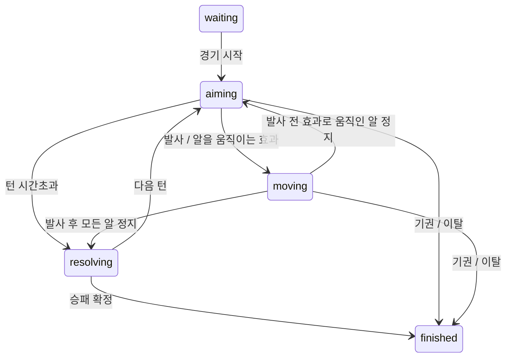

# 게임 처리·동기화 설계

## 상태

| 구분 | 상태 |
| --- | --- |
| 승인된 미구현 설계 | 아래 핵심 설계 원칙 ([DEC-013](../DECISIONS.md#결정-색인), [ADR-0003](../adr/0003-tech-stack-and-architecture.md)) |
| 현재 구현 | 없음 |
| 검토 초안 | GAME-001의 아래 상태 전이·상세 계약. API-001 상호 검토 전 |
| 미정 | 수치 기본값(GAME-002), 아래 제품 해석·후속 항목 |

제품 규칙은 [게임](../PRD.md#게임-규칙)·[방해요소](../PRD.md#방해요소-규칙), 화면 동작은 [UI](../PRD.md#화면별-요구사항)를 따른다. 선택 이유·절충은 [ADR-0003](../adr/0003-tech-stack-and-architecture.md)에 있다.

## 핵심 설계 원칙 (승인)

1. **서버 권한 (Server Authoritative)**: 물리 계산, 승패 판정, 턴 타이머, 방해요소 지급·발동, 레이팅 갱신은 서버에서만 한다. 클라이언트가 보낸 결과는 신뢰하지 않는다.
2. **실시간 진행 (승인)**: [DEC-015](../DECISIONS.md#결정-색인)의 이동 중 방해요소 사용을 지원하기 위해 서버가 고정 스텝으로 물리를 진행하고 현재 상태를 계속 전송한다. 클라이언트는 받은 상태를 보간해 표시한다. 기존 기록 후 재생 선택은 [ADR-0004](../adr/0004-realtime-hazards.md)로 대체됐다. 상세 이벤트 계약은 API-001에서 정한다.
3. **물리**: 판 평면의 2D 원 충돌을 직접 구현하고, [알 떠오름](../PRD.md#알-떠오름)은 알마다 높이 값을 따로 계산한다. 높이가 0보다 큰 알은 충돌 판정에서 빠지고, 착지할 때 판 안·밖을 판정한다. 렌더링은 클라이언트의 3D 계층에 한정한다.
4. **게임 로직 분리**: 게임 규칙, 물리, 턴 진행, 방해요소 적용은 `game-core` 패키지에 **순수 TypeScript**로 작성한다. Express, Socket.IO, DB, DOM, Three.js를 참조하지 않는다. 시간과 난수도 외부에서 주입받아(시드 기반 난수) 같은 입력이면 같은 결과가 나오게 하고, 단독으로 테스트할 수 있어야 한다. 로컬 모드와 서버가 이 패키지를 그대로 공유한다. 경계는 ESLint `no-restricted-imports`로 강제한다.
5. **데이터 기반 방해요소와 판**: 방해요소 메타데이터(id, 이름, 분류, 효과, 지속, 수치)와 판 정의는 `shared`에 데이터로 둔다. 판·알·입력에 개입하는 동작은 `game-core`의 시뮬레이션 훅과 상태 머신으로 구현한다.
6. **플레이어별 뷰 (비공개 정보)**: `game-core`는 상태를 그대로 내보내지 않고 `getViewFor(playerId)`로 플레이어별 뷰를 만든다. 상대에게 보내는 뷰에는 내 보유 방해요소의 종류·개수를 넣지 않는다. 시야 방해(후레쉬·물총)는 대상 플레이어 뷰에만 "가림 효과" 상태로 넣는다.
7. **휘발성과 영구 데이터 분리**: 방과 진행 중인 게임은 서버 메모리, 회원 / 전적 / 세션은 DB.

## 기술 초기값 (조정 대상)

아래는 구현 시작용 기본값이며 플레이 테스트로 조정한다. 길이 단위는 [판](../PRD.md#판-board)의 1단위 = 1cm를 따른다. 제품 수치(라운드·시간·크기)는 PRD를 따른다.

| 항목 | 초기값 | 비고 |
|---|---|---|
| 반발계수 | 0.9 | |
| 시뮬레이션 간격 | 고정 1/120초 | 기록 샘플링은 30fps ([운영](OPERATIONS.md)) |
| 시뮬레이션 종료 | 모든 알의 속도가 알 반지름/초 × 0.1 미만인 상태가 0.3초 지속 | |
| 시뮬레이션 최대 시간 | 10초 | 초과 시 모든 알 강제 정지 |
| 최대 발사 세기 | 알이 판 한 변 길이를 한 번 이상 이동하는 정도 | 구현 후 조정 |

## 상세 계약 초안 (GAME-001)

아래는 개발자 A의 검토안이다. [DEC-014·015](../DECISIONS.md#결정-색인)의 제품 규칙은 승인됐으며, 실시간 계산 방식은 DEC-016으로 승인됐고 이벤트 세부는 API-001 상호 검토 전이다. 선계산과 재생을 분리한 이전 초안은 이동 중 새 입력을 처리할 수 없어 이 초안으로 교체했다.

### 상태 전이와 순서

게임의 주 상태와 방해요소 효과는 별도로 관리한다. 방해요소 사용은 전용 게임 상태가 아니라 현재 상태에 효과를 추가하는 입력이다.

| 상태 | 의미 | 방해요소 입력 |
| --- | --- | --- |
| waiting | 경기 시작 전 | 거부 |
| aiming | 현재 플레이어 조준, 알은 정지 | 양쪽 모두 허용. 제한·배치 검증 후 적용 |
| moving | 알이 움직이며 계산·화면 표시가 동시에 진행 | 양쪽 모두 허용. 다음 권한 틱에 효과 반영 |
| resolving | 같은 틱 안에서 종료·라운드·교체·다음 턴을 정리 | 외부 대기 단계가 아님. 큐 입력은 전이 후 상태에서 재검증 |
| finished | 확정 결과 표시 | 거부, 결과 불변 |

- `moving`은 계산 결과 재생 단계가 아니다. 발사 도중 벽 사용 → 다음 서버 틱에서 벽 생성 → 이후 알이 벽에 부딪힘 → 그 상태를 양쪽 화면에 전송한다. 이미 지나간 충돌 결과를 소급 변경하지 않는다.
- `turnContext`는 activePlayerId, turnId, round, deadlineMs, shotCommitted를 가진다. 주 상태와 별도로 effects에 후레쉬·벽 등 활성 효과를 둔다. 기절·시야 가림만으로 주 상태를 바꾸지 않는다.
- 조준 중 책상 흔들기로 알이 움직여도 자기 알 선택·조준·발사는 계속 허용한다. 알의 현재 위치를 기준으로 입력을 검증하고 발사하며, 턴 타이머는 계속 간다. 같은 틱의 흔들기와 발사는 ingressSeq 순서로 처리한다.
- 발사 결과 승패는 모든 알이 멈춘 뒤 전체 결과로 판정한다. 양쪽 0개면 무승부다. 판 돌리기·책상 흔들기 자체는 알을 판에서 제거하지 않는다. 이 효과 뒤에 계속된 물리 움직임의 제거는 발사 전체 결과로 판정한다.
- 턴 종료가 확정되면 completedTurns를 한 번 증가시킨다. 2턴마다 라운드가 끝난다. 종료 판정 → 필요한 방해요소 교체 → 다음 턴 주인 변경 → 회복·쿨타임·자동 발동 처리 → 플레이어별 뷰·turn:change 순이다. 교체는 1·3·5·7·9라운드 시작에 보유 1개와 그 게이지·쿨타임·지속 효과를 지우고 새 방해요소로 교체한다. 판·알에 이미 반영된 즉시 효과의 상태는 되돌리지 않는다.

### 명령 경합과 시간

- 경기별 단일 큐에 서버 관찰 순번 ingressSeq와 단조 시각 observedAtMs를 붙인다. 같은 틱 입력은 순번대로 처리한다. 클라이언트 시각으로 과거 틱을 변경하지 않는다.
- 고정 틱마다 마감·효과 만료 정산 → 대기 명령 검증·적용 → 물리 적분·충돌·착지·제거 → 정지·종료 판정 → 플레이어별 상태 전송 순이다. 실제 시간과 물리 진행을 같은 권한 시간축에 맞추며 CPU 계산 완료 시간을 게임 경과로 삼지 않는다.
- 발사는 관찰 시각이 deadlineMs보다 작아야 한다. 정확히 마감이면 시간초과가 우선이다. 발사 시 해당 플레이어의 연속 시간초과를 0으로 만들고 턴 타이머는 끝낸다. 시간초과는 플레이어별 누적·강제 기권 조건을 PRD대로 적용한다.
- 방해요소는 발사 전후 모두 허용하므로 같은 틱에 발사가 먼저 처리돼도 방해요소를 단순히 moving이라는 이유로 거부하지 않는다. 종료·교체·제한 상태는 순서대로 재검증한다.
- 명령은 gameId, turnId, commandId를 가진다. 방해요소는 추가로 hazardInstanceId를 보내 교체 전 카드 명령을 거부한다. 같은 commandId는 최초 결과만 반환하고 중복 실행하지 않는다. 오류·보관 범위는 API-001에서 정한다.
- 이탈·기권·접속 대체도 같은 큐를 거친다. 먼저 관찰된 이탈자를 기권패 처리하며 동시 시각은 ingressSeq로 구분한다. 시작 커밋 전 이탈은 대기실 처리다. finishOnce로 종료 후 결과를 바꾸거나 중복 저장하지 않는다.
- 로그 필드는 경기·턴 ID, UTC·단조 시각, ingressSeq, serverTick, 명령 종류·판정 결과다. 비공개 보유 상태 전체를 로그에 복사하지 않는다.
- 초 단위 효과는 expiresAtMs까지 유지한다. 조준과 이동 사이에서 타이머를 새로 시작하거나 중복 차감하지 않는다. 서버 지연 시 따라잡기 틱 수·전송 주기·클라이언트 보간 지연은 측정 후 기술값으로 정한다.

### 상태 위치와 플레이어별 뷰

| 위치 | 필드 |
| --- | --- |
| 경기 내부 | phase, serverTick, revision, turnContext, completedTurns, board, stones(좌표·높이·속도), effects, result, 독립 PRNG 스트림 |
| 본인 비공개 | heldHazard(instanceId·kind·교체 라운드), 현재 방해요소의 fatigue·cooldown 상태, timeoutStreak |
| 공개 GameView | gameId, serverTick, serverNowMs, revision, phase, turnId, round, activePlayerId, deadlineMs, 판 변환, 알(id·ownerId·x·y·h), 공개 활성 효과·발동 안내, 확정 결과 |
| 본인 private | heldHazard, 게이지·쿨타임·사용 가능 여부, 내 연속 시간초과, 대상 화면 가림 |

`getViewFor(playerId)`는 허용 목록으로 새 객체를 만든다. 상대 보유 종류·교체 추첨 결과·게이지·쿨타임·난수 시드는 보내지 않는다. 보유 개수도 별도 전송하지 않는다. 사용된 효과의 이름과 효과는 양쪽 공개하고 화면 가림 표현은 대상 뷰에만 담는다.

### 방해요소별 처리

직접 사용형은 aiming과 moving 양쪽에서 처리한다. 슬롯은 1개이며 비용·쿨타임 검증에 실패한 입력은 상태와 난수를 바꾸지 않는다. 효과별 대상과 제한의 미정 항목은 아래를 따른다.

| 종류 | 적용 훅·상태 |
| --- | --- |
| 판 돌리기 | 기본 판 돌리기의 상대 턴 제한과 독립적으로 보유 중 언제든 사용. 판·알 좌표 회전 후 알을 판 안에 유지. 알의 속도 벡터·벽·끈끈이의 위치와 방향도 같은 각도로 회전. 카메라는 고정 |
| 후레쉬 | 대상 뷰에 만료 시각을 가진 화면 가림 추가, 물리에는 영향 없음 |
| 물총 | 대상 뷰에 별도 가림 추가, 물리에는 영향 없음 |
| 책상 흔들기 | 시드 난수로 현재 알 위치 이동. 결과 좌표는 판 안으로 보정하고 이 효과 자체로 제거하지 않음. 흔들리는 중에도 조준·발사 허용 |
| 벽 | 판 좌표계의 격자 후보 중심과 방향으로 배치. 판 밖·알·기존 벽·끈끈이와 겹치면 거부. 이후 틱 충돌에 반영. 떠 있는 알과의 접촉 규칙은 물리 설계에 따름 |
| 끈끈이 | 원 영역 추가, 지면 알의 적분 전 감속 적용 |
| 기절 | 사용자의 턴과 관계없이 상대의 조준·발사 입력 차단·만료 시각 관리. 이미 움직이는 알을 멈추거나 발사를 취소하지 않음 |
| 세기 막대 속도 조절 | 보유 중 턴과 관계없이 상대에게 확률적 자동 발동. 약 1초 발동 중 막대 조작에만 배율 적용. 조준하지 않으면 조작 변화 없음 |
| 바람 | 보유 중 턴과 관계없이 상대에게 확률적 자동 발동. 약 1초 동안 상대의 조준 방향에 자동 편향을 더함. 상대가 조작하지 않아도 방향이 움직임. 알의 속도·좌표에는 영향 없음 |

### 물리와 입력 경계

- 판 중심 원점, 선공 기준 오른쪽 x·상대 방향 y·높이 h. 후공 화면은 180도 돌리며 판 평면 ray 교차점을 역변환해 기준 좌표 명령을 보낸다.
- 효과 만료·명령 적용 후 가속/감속 → 이동 → 벽·원 충돌 → 겹침 보정 → 착지·판 이탈 → 정지 판정 순으로 고정한다. 알 ID 순으로 접촉을 안정적으로 처리하며 swept 충돌로 터널링을 다룬다.
- 세기 p를 수평 속도 v(p), 높이 H(p)로 변환한다. 떠오름은 h(t)=vz·t−g·t²/2, vz=sqrt(2gH). PRD의 문턱·높이 한도를 따르며 떠 있는 알은 알 충돌에서 제외하고 착지 시 판 이탈을 검사한다.
- 판 이탈은 `game-core`의 직접 구현한 물리 계산에서 판 모양별 경계를 판정한다. 지면 알의 중심이 판 영역 밖으로 넘어가면 제거하고, 떠 있는 알은 착지 때 같은 기준으로 검사한다. 정사각형·원형판의 영역 함수와 벽·알 충돌은 같은 좌표계를 쓴다. 경계값의 허용 오차는 GAME-002에서 조정한다.
- 벽 배치 미리보기는 판 좌표계 격자에 맞춰 후보를 스냅하고 실제 배치 검증과 같은 기하 조건을 사용한다. 판 밖·알·기존 벽·끈끈이와 겹치지 않는 후보만 초록색, 나머지는 빨간색으로 표시한다. 서버가 확정 시 현재 상태로 다시 검증하므로 이동 중 알이 후보에 들어오면 거부될 수 있다. 격자 간격·벽 두께는 GAME-002 기술 초기값으로 제안한다.
- BoardDefinition은 영역 판정·초기 배치·표시 메타데이터를 분리한다. 제거 알은 재충돌하지 않는다. 물리 훅은 beforeIntegrate, onContact, onLanding, onExit, afterStep, onSettled다. shared에는 직렬화 가능한 데이터만 둔다.
- `game-core`는 외부에서 tick 시간·명령·난수를 주입받는다. 네트워크·DB·DOM을 참조하지 않는다. AI도 자기 뷰만 보고 같은 명령 검증을 거친다. 온라인은 서버, 로컬은 LocalGameSession 어댑터가 AI 입력을 예약하는 안이다.

### 전송과 표시 초안

- 서버는 현재 틱의 플레이어별 스냅샷을 계속 보내고 클라이언트는 짧은 버퍼로 보간한다. 틱·revision이 오래된 상태는 버린다. 경기 전체 결과를 기다렸다가 재생하지 않는다.
- game:state를 상태 전송에 사용하고 hazard:triggered는 적용 틱·효과를 알린다. 기존 sim:result 일괄 기록 이벤트는 이 초안에서 사용하지 않는다. 이름·필드·응답·유실 시 정합성은 API-001에서 확정한다.
- 클라이언트 표시의 네트워크·보간 지연은 존재한다. 렌더링 프레임률과 서버 물리·전송 주기를 구분하고 지연·대역폭·서버 부하를 측정한다. 낙하 연출은 표시 계층에 둔다.

## 미정 사항

- GAME-002: 물리 수치·반복 상한·마찰·높이 곡선·서버 물리 및 전송 주기·보간 지연.
- 제품 해석: 랜덤형 15초 구간 내 약 1초 발동의 세부 추첨 방식·확률, 효과 진행 중 재사용·상호 배제 범위, 턴 수 기반 쿨타임의 시간 환산.
- 제품 해석: 조준 중 움직임 효과와 30초 마감이 같은 시각일 때의 처리, 벽 방향·격자 간격·두께·경계 허용 오차·시뮬레이션 최대 시간 처리.
- API-001 상세 이벤트 상호 검토. ADR-0004의 실시간 방식은 승인됨. LOCAL-001에서 양쪽 동시 입력·단일 PC 조작 방식을 정한다.

제품 규칙은 PRD, 기술 선택 이유는 ADR, 검증 결과는 worklog에서 관리한다.
